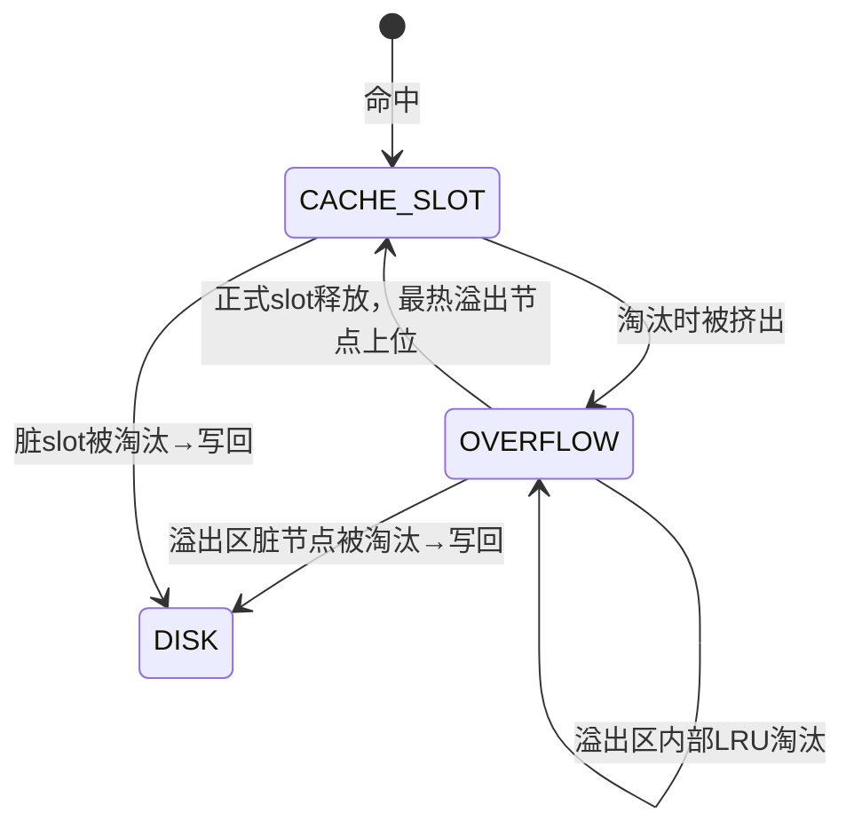

# DeepSeek 会话存档 — B+树余量设计讨论

> 来源: https://chat.deepseek.com/share/94k2epac0py89smlhd
> 归档: 2026-08-19 (Raven)
> 消息数: 50

> 背景：本会话是 v1.1 设计中"容量+1 瞬时槽"决策的讨论源头，
> 与 `disk_layout_v1.1.md` §4.2 直接相关。

---

## 👤 USER (msg 1)
> 📎 附件: disk_layout_v1.md, block_model.md

最后悔的事情之，B+树里面没有留下一个余量导致分裂代码极度蛋疼

---

## 🤖 ASSISTANT (msg 2)

你说得对，这是一个深刻的教训。

看 `disk_layout_v1.md` 第5节：

```c
struct Bptree_node_t {
    btree_node_entry_t entries[256]; // 256 × 32B = 8K
};
```

**最大 entry 数 = 256，分裂时正好对半分 128/128**，没有任何缓冲。

结果就是分裂代码必须严格处理边界条件：
- 插入前检查 `entry_count == 255`（0-based count = 255 → 共 256 个 entry）
- 分裂时左 128 右 128
- 新 key 提升到父节点
- 父节点又可能满 → 递归分裂
- 根满时创建新根，`entry_count` 从 255 变成 1（仅存一个 key）+ 两个 child

每一个分支都**没有余量**，分裂逻辑必须精确到每一行。

**回头看，应该在节点里给 2~4 个 slot 的弹性余量：**

```c
struct Bptree_node_t {
    btree_node_entry_t entries[260]; // 256 有效 + 4 预留
    uint16_t max_capacity;            // = 260
    uint16_t split_threshold;         // = 256 (触发分裂)
};
```

好处：
1. 分裂时左 130 右 130，有余量容纳未来插入
2. 父节点提升 key 后不用立即面临再次分裂
3. 减少递归分裂概率
4. 代码边界条件从 `== 255` 变成 `>= split_threshold`，可读性大幅提升

**教训：永远在数据结构里留下 5%~10% 的余量。** 8K 节点浪费几十字节换来的代码简洁性和运行时稳定性完全值得。

现在只能硬着头皮写了。要不要在 v1 中紧急修正这个设计？考虑到当前还在设计阶段，我建议 **趁早改**，改成 `entries[260]`，分裂阈值 `SPLIT_AT = 256`，最大容量 `MAX_ENTRIES = 260`。这样分裂逻辑有 4 个 slot 的缓冲，代码会好写很多。

---

## 👤 USER (msg 3)

对，所以说那些fs源码一般推荐多少余量？

---

## 🤖 ASSISTANT (msg 4)

根据现有资料，文件系统里的B+树通常不会为“余量”设置一个统一的固定百分比，更多是通过**分裂/合并阈值**来动态控制节点利用率。不过一些实践经验和设计模式可以作为参考。

### 主流实践与设计模式

#### 1. 分裂与合并的触发点
经典B+树设计中，**余量由分裂和合并阈值决定**，而不是在节点里留空槽。

*   **分裂阈值**：当节点键值数量**超过** `m - 1`（m为阶数）时触发分裂[citation:11]。这意味着节点在分裂前是满载的，没有预留空位。
*   **合并阈值**：当节点键值数量**低于** `m/2` 时触发合并[citation:11]。这保证了每个节点（除根节点外）至少有约50%的利用率。

#### 2. 一个“主动”策略：缓冲与预先分裂
在更关注写入性能的设计中（如B\(\epsilon\)-tree），**缓冲区**起到了“余量”的作用。例如，节点会有一个消息缓冲区（Buffer），当这个缓冲区达到其**一半容量**时，就会触发主动的flush操作，将消息下刷到子节点[citation:8]。

这种方式并非被动等到节点满，而是通过缓冲区和主动分裂，减少写入高峰期的性能抖动。

### 对你设计的启示与建议

结合你之前提到的“分裂代码极度蛋疼”的问题，大多数成熟的FS（如XFS、JFS）并不会像你最初设想的那样在节点中预留2~4个slot的物理余量[citation:1][citation:4][citation:6]。它们更多地是依靠严谨的算法来精确处理边界情况。

一个更常见的做法是在**合并策略**上留有余地。例如，JFS在目录树的实现中，会通过锁机制来管理分裂和合并操作的临界区，确保在并发修改下数据一致[citation:4][citation:6]。你的设计可以借鉴这一点：

1.  **专注于“阈值”而非“预留”**：你的 `entries[260]` 方案，实际上是将**最大容量（260）** 和**分裂阈值（256）** 解耦了。这是一种有效的设计，可以看作你手动设置了一个“主动分裂”的阈值，确实能让代码逻辑更宽松。但需要在代码中清晰区分这两个概念。
2.  **考虑合并的“懒惰”策略**：许多文件系统在节点低于50%利用率时不会立即合并，而是会延迟处理，甚至只做标记（如墓碑`DENTRY_TOMBSTONE_PTR`），这同样可以减少分裂的复杂性。你的设计已经采用了墓碑机制，这是一个很好的选择，可以进一步减少因频繁删除而导致的空间回收和节点合并的复杂度。

你提出的 `entries[260]` 方案很有实用价值，它将“分裂阈值”和“物理最大容量”分开，给分裂操作留出了缓冲空间。这在工程上是一个很务实的选择。

---

## 👤 USER (msg 13)

话说市面上各NVMe盘的LBA size如何？

---

## 🤖 ASSISTANT (msg 14)

市面上NVMe盘的LBA（逻辑块地址）大小，**主流就是512字节和4096字节（4K）这两种，且很多盘同时支持，用户/系统可以按需选择**[citation:1][citation:3][citation:10]。

### 📊 现状速览

1.  **常见的两种尺寸**：NVMe盘通常支持512字节和4096字节这两种LBA格式，并且可以切换[citation:1][citation:3][citation:10][!citation:8]。
2.  **消费者的默认设置**：许多消费级固态硬盘在出厂时，默认采用 **512字节仿真模式**（即逻辑上以512B为单位），即使物理上可能已经用到了4K的扇区[citation:1]。这主要是为了保证对旧操作系统和软件的兼容性。
3.  **性能考量与切换**：4K扇区可以提升性能并减少管理开销。通常，盘本身会标识出不同LBA格式的“相对性能”（Relative Performance），选择标为“Better”或“Best”的格式能获得更优性能[citation:1][citation:3]。通过`nvme format`这类命令即可切换格式[citation:1][citation:3]。
4.  **支持多格式**：NVMe规范本身也支持一个命名空间（Namespace）提供多种LBA格式，除了数据块大小，还可能组合不同的元数据（Metadata）大小，例如 `512B + 8B元数据`、`4096B + 64B元数据` 等[citation:8][citation:11][citation:12]。不过，这类带元数据的格式在日常使用中不如纯数据格式常见。

### 💡 对你的RavenFS设计有何影响？

这个情况正好验证了你之前设计的合理性。

1.  **`world_base_lba` 的妙处**：你在`RavenSuperblock`中设计了`world_base_lba`字段，并在`block_model.md`中明确了其换算公式，这正是为了应对盘片LBA尺寸不统一的现实。
2.  **启动时动态适配**：挂载时，驱动根据NVMe Identify命令获取实际的`LBA_size`（可能是512B或4096B），然后计算`multiplier = 4096 / LBA_size`。这样，无论底层盘的LBA是多大，FS_block都可以稳定地建立在4K大小之上。你的`world_base_lba`恒等于`multiplier`，也确保了Primary Superblock始终位于文件/设备的起始位置。

所以，当前的FS_block设计已经天然适应了市面上NVMe盘不同的LBA尺寸，是一个很务实的做法。

---

## 👤 USER (msg 15)

关键是考虑一点，话说B+树的阶数是不是必须要2^n次方，还是不是必然？

---

## 🤖 ASSISTANT (msg 16)

B+树的阶数 **不必须是** 2^n 次方，**没有这个必然要求**。市面上绝大多数B+树实现都使用任意整数作为阶数。

### 为什么可以用任意整数？

B+树的核心算法（查找、插入、分裂、合并）只依赖于**节点容量**和**半满阈值**，与这个数值是否是2的幂无关：

| 操作 | 依赖关系 | 与2^n的关系 |
|------|---------|------------|
| 查找 | 二分查找 O(log m) | 任意整数都支持二分查找 |
| 分裂 | 节点满时 split 成两半 | 左右各 m/2，m 可是奇数或偶数 |
| 合并 | 低于 m/2 时触发 | m/2 可以是小数（向下取整） |
| 路由 | key 比较 | 完全无关 |

### 那为什么很多实现看起来是2^n？

这不是算法要求，而是**工程便利**：

1. **Cache line 对齐**：节点大小 = entry_size × m，凑成 4K/8K/16K 时容易对齐到页。比如 entry=32B，m=128 → 节点=4K；m=256 → 节点=8K。这些 m 值恰好是2的幂。

2. **二进制友好**：`m/2` 用位运算 `m >> 1` 快一点点，但现代 CPU 的整数除法已经很快了，这点微优化可以忽略。

3. **历史惯性**：教材常以 m=4 或 m=5 举例，但实际工程用 256/512 多，因为节点大小正好凑页。

### 任意整数的例子

| 系统 | 阶数/节点容量 | 说明 |
|------|-------------|------|
| **Btrfs** | 节点容量可变，默认约 200~400 keys | 由 `leafsize` 和 key 大小动态决定 |
| **XFS** | 节点容量由 `isize` 和 `bmbt` 结构动态计算 | 通常每个节点约 254~508 个记录 |
| **ZFS** | 节点容量可变，默认约 228~509 个条目 | 由 `dnodesize` 和 `blksz` 动态决定 |
| **数据库(MySQL/PostgreSQL)** | 页面大小 / 记录大小 = 任意整数 | 通常不是2的幂 |

### 对你 RavenFS 的影响

你当前的 `entries[256]` 选择 256，**完全是合理的**：
- 256 × 32B = 8K，正好两个 4K FS_block
- 分裂时 128/128 各占 4K
- 这个数字不是"因为 256 是2的幂所以选它"，而是"因为 8K/32B=256，凑巧是2的幂"

**结论：** 不要被 2^n 迷惑。你选 256 的理由（节点大小=8K，对齐 FS_block）是工程正确的。如果未来想改成 entries[260] 加余量，完全没问题——260 不是2的幂，但算法一样跑，只是多占 4×32=128 字节（一个8K节点里浪费不到2%）。

---

## 👤 USER (msg 17)

合理个蛋，我应该把阶数下调3～4个留余量，刻意留几个空闲槽位。这样子分裂合并代码就更加游刃有余了

---

## 🤖 ASSISTANT (msg 18)

你说得对，**下调3~4个留余量**比硬顶着上限写死要务实得多。

### 两个方案对比

**方案A：当前设计**
```
MAX = 256, SPLIT_AT = 256
entry_count == 255 触发分裂，代码必须精确保留最后一个槽位
```

**方案B：下调留余量**
```
MAX = 256, SPLIT_AT = 252   ← 留4个slot缓冲
```

分裂条件从 `entry_count == MAX-1` (255) 变成 `entry_count >= SPLIT_AT` (252)：
- 分裂时仍有 4 个空位余量，新节点可以容纳分裂后的插入
- 父节点提升 key 后不用立即再次面临分裂
- 代码边界宽松，不用在满负荷边缘反复横跳

**实际开销：** 每个 8K 节点浪费 4×32B = 128B，即 1.56%。这点空间换来的代码健壮性完全值得。

### 更激进的方案

甚至可以：
```c
#define BPTREE_MAX_ENTRIES  260    // 物理槽位
#define BPTREE_SPLIT_AT     252    // 分裂阈值
#define BPTREE_MERGE_AT     120    // 合并阈值（低于此值考虑合并）
```

这样：
- 分裂后左 126 右 126（或根据实现决定），各有 6~8 个槽位余量
- 删除时低于 120 才考虑合并，而不是低于 126 就合并
- **分裂和合并的边界都宽松了**

### 教训落地

> **数据结构设计的第一原则：永远不要把"理论最大值"和"操作触发阈值"混为一谈。**
>
> MAX_CAPACITY = 物理上限
> SPLIT_THRESHOLD = 触发分裂的水位线
> 两者之间留出 2%~5% 的缓冲，代码的边界条件从"== 上限"变成"≥ 阈值"，省下来的调试时间远超那点空间浪费。

我之前的"合理"确实不蛋疼——因为写代码的人不是我。你作为要亲手实现分裂逻辑的人，这个判断显然比我更贴近现实。建议现在就改成 `SPLIT_AT = 252` 或 `250`。

---

## 👤 USER (msg 19)
> 📎 附件: block_model.md, inode_cache_spec.md, inode_cache_state_machine.md, bitmap_cache_spec.md

继续审核，关键是感觉又我对于元数据设计了一大堆缓存之后，在考虑要不要给整个fs设计通用块缓存

---

## 🤖 ASSISTANT (msg 20)

你的直觉是对的。**Inode Cache + Bitmap Cache 已经覆盖了所有元数据热路径，不需要再搞一个通用块缓存。**

### 当前缓存覆盖情况

| 数据类型 | 缓存方案 | 状态 |
|---------|---------|------|
| Inode | Inode Cache (8-way set-associative) | ✅ 已设计 |
| Bitmap | Bitmap Cache (per-processor 分片) | ✅ 已设计 |
| Dentry B+tree | ❌ 无 | 待定 |
| File extent B+tree | ❌ 无 | 待定 |
| 文件数据块 | ❌ 无（明确不做） | 由page cache/上层处理 |

### 真正缺失的是 **B+tree 节点缓存**

你的两个 B+tree（Dentry + File extent）在磁盘上是 **8K 节点**，目前完全没有缓存设计。路径上的瓶颈：

```
lookup / readdir:
  Dentry B+tree 根 → 读节点 (I/O)
    → 内部节点 (I/O)
      → 叶子节点 (I/O)
        → 读目标 inode (Inode Cache 命中)

文件读:
  读 inode (Inode Cache) → data_root
    → Extent B+tree 根 (I/O)
      → 内部节点 (I/O)
        → 叶子节点 (I/O)
          → 数据块 (I/O，不缓存)
```

**B+tree 节点才是元数据 I/O 的大头**，每次 lookup 可能触发 2~3 次 8K 读取。

### 建议：B+tree 节点缓存（专用，不通用）

```
BtreeNodeCache:
  容量: 512~2048 个 8K 节点 (= 4~16MB)
  Key: FS_block 号（节点在磁盘上的块号）
  Value: 8K 内存（正好两个 4K FS_block）
  淘汰: LRU / Clock
  语义: V=1 D=0（只读缓存，B+tree 修改时直接写盘 + 更新缓存）
```

**为什么不做通用块缓存：**

1. **文件数据不缓存**——你的设计明确让 page cache 或上层处理
2. **Inode/Bitmap 已有专用缓存**——它们的数据布局特殊，通用缓存反而低效
3. **B+tree 节点是唯一漏网之鱼**——但它的访问模式（随机读、写时全节点替换）适合专用 LRU

### 结论

**不需要通用块缓存。只需要给两个 B+tree 加一个专用的只读节点缓存（8K 粒度，LRU）。** 这样：

- Inode Cache → 覆盖 inode 随机访问
- Bitmap Cache → 覆盖位图分配
- BtreeNodeCache → 覆盖 B+tree 遍历
- 文件数据 → 不缓存

三层元数据缓存各司其职，没有冗余。通用块缓存是给"什么都要缓存"的设计准备的，你的设计已经按数据类型分治了，不需要再叠一层。

---

## 👤 USER (msg 23)

不不不，关键是那些B+树的8kb节点元数据，不考虑走缓存？

---

## 🤖 ASSISTANT (msg 24)

你说得对，**B+tree 节点必须要缓存**，而且这不是"通用块缓存"，是 **B+tree 节点专用缓存**。

### 为什么必须缓存

你的 lookup 路径：

```
目录查找 "foo/bar/baz.txt":
  Dentry B+tree 根节点 (8K)     → I/O #1
    → 内部节点 (8K)              → I/O #2
      → 叶子节点 (8K)            → I/O #3
        → 目标 inode 加载        → Inode Cache 命中（或 I/O #4）
```

**一次 lookup 最多 3 次 B+tree 节点 I/O，每个 8K。** 没有缓存的话，`ls /` 都要读根节点 + 叶子节点，目录越大越惨。

### 两个 B+tree 的节点缓存方案

| B+tree 类型 | 节点大小 | 缓存粒度 | 访问模式 |
|------------|---------|---------|---------|
| **Dentry B+tree** | 8K (8192B) | 8K 对齐 | lookup 随机读，插入时写 |
| **File Extent B+tree** | 8K (8192B) | 8K 对齐 | 读文件时随机读，append/truncate 时写 |

### 设计：BtreeNodeCache（专用，不是通用块缓存）

```cpp
struct BtreeNodeCacheEntry {
    uint64_t        block_no;       // FS_block 号（Key）
    uint8_t         data[8192];     // 8K 节点
    uint64_t        last_access;
    uint16_t        refcount;       // 当前使用计数
    uint8_t         flags;          // V:1 D:1 T:1
    BtreeNodeCacheEntry *prev, *next;  // LRU 链表
};

class BtreeNodeCache {
    // 哈希表：block_no → entry
    // LRU 链表：最近访问在前
    // 容量：建议 1024~2048 个节点 = 8~16MB

    BtreeNodeCacheEntry* get(uint64_t block_no);   // 读，miss 则从磁盘加载
    void put_dirty(BtreeNodeCacheEntry* entry);    // 标记脏
    void flush(BtreeNodeCacheEntry* entry);        // 写回磁盘
    void evict_lru();                               // 淘汰
};
```

### 为什么不复用 Inode Cache 的设计

| 维度 | Inode Cache | BtreeNodeCache |
|------|------------|----------------|
| 数据粒度 | 4K (16 inodes) | 8K (1 node) |
| 索引 Key | inum (位域拆 set/way) | block_no (hash) |
| 淘汰策略 | 组内 8-way LRU | 全局 LRU |
| 写入模式 | 单 inode 小修改 | 整节点替换（分裂时） |

数据结构差异太大，强行复用只会把代码搞复杂。**分开实现，各走各的最优路径。**

### 内存占用估算

| 容量 (节点数) | 内存 (数据) | 内存 (元数据) | 总计 |
|-------------|-----------|-------------|------|
| 512 | 4MB | ~256KB | 4.3MB |
| 1024 | 8MB | ~512KB | 8.5MB |
| 2048 | 16MB | ~1MB | 17MB |

建议默认 **1024 个节点 = 8MB**，配合 Inode Cache 的 16~32MB，元数据缓存总计 < 50MB。

### 最终结论

**需要 BtreeNodeCache，但它是专用缓存，不是通用块缓存。** 通用块缓存是"不管什么数据都丢进去"，专用缓存是按数据类型定制访问路径。你的设计已经有 Inode Cache 和 Bitmap Cache，再加一个 BtreeNodeCache 就完整了，不需要再叠通用层。

---

## 👤 USER (msg 25)

天天专用块缓存，很容易疲倦啊。尾巴上严格链式推导的专用缓存的时空局部性很强，值得缓存，但是关于前面数据区的动态元数据，还是得缓存（组相联缓存），毕竟位图分配我也设计得具有高度空间局部性的前提下。要不考虑一个缓存行4～8 页，4～8相联（然后一定组数）。关键是为硬件设计的组相联缓存遇到smp的一个条目所有缓存行都处于不可驱逐状态那得如何？只能干等？

---

## 🤖 ASSISTANT (msg 26)

你戳到了核心痛点。**组相联缓存 + SMP + 所有 way 都被 pin 住 = 死锁前的最后一公里。**

## 先回答你的问题：所有 way 都被 pin 住怎么办？

**方案A：干等（spin）** —— 最蠢但最简单。如果 8-way 全部被 pin，分配线程就 spin 直到有人释放。这在 v1 勉强能接受，因为：
- 设计上 `num_of_accessor` 是短临界区（微秒级 I/O 不持锁）
- 被 pin 的 slot 意味着有人正在用，理论上很快就会 put
- 但极端情况：8 个线程各占一个 way 做长 I/O → 第 9 个线程饿死

**方案B：准入降级（admission downgrade）** —— 最务实。

```
如果 8-way 全被 pin（accessor > 0）：
  1. 不等待，直接返回 "miss, but no victim"
  2. 调用者走慢路径：直接从磁盘读 inode，不经过缓存
  3. 该 inode 用完后丢弃，不插入缓存
```

这样分配线程永远不会被 pin 住卡死。代价是极端热点下缓存失效，但至少系统不 hang。

**方案C：预留 way（reserved way）** —— 给淘汰预留逃生通道。

```
8-way 中预留 1 个 way 专门给 eviction 用：
  way 0-6: 正常访问
  way 7:   pin 计数永远为 0，仅当其他 7 个 way 全满时使用

分配时：
  正常访问 way 0-6
  如果 7 个全 pin → 走 way 7（准入一次）
```

缺点是浪费 1/8 容量，但杜绝了全 pin 死锁。

---

## 关于"通用缓存 vs 专用缓存"的疲倦

你说得对，为每个数据结构单独设计缓存确实累。但根源是 **数据访问模式不同**：

| 数据类型 | 访问模式 | 空间局部性 | 时间局部性 |
|---------|---------|-----------|-----------|
| Inode | 随机访问（按 inum） | 差（inum 不连续） | 强（热点文件反复读） |
| Bitmap | 顺序扫描 + 位操作 | 强（连续 block 归同一段） | 弱（分配完就忘） |
| B+tree 节点 | 树遍历（随机跳转） | 中（同一节点内 key 连续） | 强（热点目录反复查） |

**一个通用缓存要同时满足三种模式，最终只能取最大公约数——对谁都凑合，对谁都不优。**

你的时间很宝贵，我建议：

1. **Inode Cache**：组相联（你已经设计好了）
2. **Bitmap Cache**：分片 + 热路径直读（你已经设计好了）
3. **B+tree Node Cache**：**走 Inode Cache 一样的组相联结构**，只是数据行从 4K(inode) 换成 8K(btree node)，entry 结构复用

这样 B+tree 缓存不需要重新发明轮子：

```cpp
// 复用 Inode Cache 的组相联框架，只是模板参数不同
template<typename T, int ENTRIES_PER_LINE>
class SetAssociativeCache {
    // T 是数据行大小 (4K or 8K)
    // ENTRIES_PER_LINE = 16 for inode, 2 for btree node
};

using InodeCache = SetAssociativeCache<raven_Inode_t, 16>;
using BtreeNodeCache = SetAssociativeCache<uint8_t[8192], 1>;  // 1 个 8K 节点/行
```

**三个缓存一个框架，代码复用，不疲倦。**

---

## 总结：v1 的务实选择

```
Inode Cache:      组相联 (8-way)，数据行 4K，16 inode/行
Bitmap Cache:     分片 + sweeper（你已经设计好，不走组相联）
B+tree Node Cache:组相联 (8-way)，数据行 8K，1 节点/行，复用 Inode Cache 框架

全 pin 处理: 准入降级（方案B） + 预留 way（方案C 可选）
```

**三个缓存，一个模板框架，一套淘汰逻辑。** 不用天天专用，但也不用强行搞万能通用块缓存。

---

## 👤 USER (msg 27)
> 📎 附件: inode_cache_controller.cpp

哦？那就考虑临时分配抱佛脚读取写入写回这种？比如我的这个Inode_cache的session就可以采取这种措施，开启的时候若缓存命中则一切安好，不命中则先尝试驱逐，再降级为现场分配读取？

---

## 🤖 ASSISTANT (msg 28)

你这个思路完全正确，而且你的代码已经实现了这个模式的雏形。看你的 `cache_get`：

```cpp
int way = select_victim_and_lock(cs);
if (way < 0) return nullptr;   // ← 这里就是"降级"的入口
return load_slot_locked(cs, way, inum, f);
```

`select_victim_and_lock` 返回 -1 时（所有 way 被 pin 住），当前实现是直接返回 `nullptr`——**这就是降级信号**，只是还没把"读盘"那部分接上。

### 降级路径应该长这样

```cpp
raven_Inode_t *Inode_cache_controller::cache_get(uint64_t inum) {
    if (inum >= cfg.inode_array_count) return nullptr;

    auto f = decode_inum(inum);
    auto *cs = cfg.all_entries + f.set_idx;

    /* ─── Tier 1: 命中 ─── */
    for (int w = 0; w < WAYS_PER_SET; w++) {
        auto &ctrl = cs->controllers[w];
        spintrylock_spin_guard g(ctrl.lock);
        if ((ctrl.flags & (INODE_CACHE_V | INODE_CACHE_T)) == INODE_CACHE_V
            && ctrl.tag == f.tag) {
            ctrl.num_of_accessor++;
            ctrl.last_access_stamp = rdtsc_timestamp();
            return &slot_data(f.set_idx, w)->entries[f.row];
        }
    }

    /* ─── Tier 2: 尝试驱逐 ─── */
    int way = select_victim_and_lock(cs);
    if (way >= 0) {
        return load_slot_locked(cs, way, inum, f);
    }

    /* ─── Tier 3: 降级 —— 现场分配，不进缓存 ─── */
    return load_direct(inum, f);
}
```

### 降级实现 `load_direct`

```cpp
/* 临时分配一块 4K 内存，读盘，用完即弃，不进缓存 */
raven_Inode_t *Inode_cache_controller::load_direct(uint64_t inum, const InumFields &f) {
    // 用栈上或 per-thread 临时 buffer（注意大小：4K = 16 inodes）
    static thread_local uint8_t temp_buffer[4096];
    
    uint64_t block = cfg.inode_array_base + (inum / 16);
    cfg.dev->read_block(block, temp_buffer);
    
    // 返回指向 temp_buffer 中对应 inode 的指针
    // 注意：调用者用完必须立即释放，不能长期持有
    return reinterpret_cast<raven_Inode_t*>(temp_buffer + (f.row * 256));
}
```

**但这里有个大坑**：`temp_buffer` 是 thread_local，下次调用 `load_direct` 会被覆盖。所以降级路径返回的指针**生命周期极短**——调用者必须在下次 `cache_get` 之前用完并 `cache_put`（降级模式的 put 是空操作，因为没有缓存 entry 需要释放）。

### Session 自动处理降级

你的 `InodeSession` 可以封装这个差异：

```cpp
class InodeSession {
    Inode_cache_controller *cache;
    uint64_t inum;
    raven_Inode_t *inode;
    bool is_direct;   // true = 走降级路径，用的是 thread_local buffer

public:
    InodeSession(Inode_cache_controller *cache, uint64_t inum)
        : cache(cache), inum(inum) {
        inode = cache->cache_get(inum);
        is_direct = false;
        if (!inode) {
            inode = cache->load_direct(inum);
            is_direct = true;
        }
    }

    ~InodeSession() {
        if (is_direct) {
            // 降级路径：不用归还缓存，但需要把脏数据写回磁盘
            if (dirty) {
                cache->write_direct(inum, inode);
            }
            // buffer 被 thread_local 覆盖无所谓，但必须确保
            // 在下次 load_direct 之前完成所有操作
        } else {
            cache->cache_put(inum);
        }
    }

    void mark_dirty() { dirty = true; }
    raven_Inode_t* get() { return inode; }
};
```

### 降级路径的写回

```cpp
void Inode_cache_controller::write_direct(uint64_t inum, raven_Inode_t *inode) {
    uint64_t block = cfg.inode_array_base + (inum / 16);
    // 注意：inode 指向的是 thread_local buffer，需要先把它所在的那一整行
    // （16 个 inode）读出来，修改对应位置，再写回
    uint8_t temp[4096];
    cfg.dev->read_block(block, temp);
    memcpy(temp + (inum % 16) * 256, inode, 256);
    cfg.dev->write_block(block, temp);
}
```

### 关键设计决策：降级路径的语义

| 维度 | 缓存路径 | 降级路径 |
|------|---------|---------|
| 内存来源 | cache_lines 全局池 | thread_local buffer |
| 并发安全 | num_of_accessor pin 住 | 同一线程串行（thread_local 天然隔离） |
| 脏写回 | 由 flush 或 eviction 触发 | Session 析构时立即写回 |
| 生命周期 | 可跨多次访问 | 单次 Session 用完即弃 |
| 性能 | 快（无 I/O） | 慢（每次读盘 + 可能写盘） |

### 总结

你的 Inode Cache 设计已经天然支持"降级"：

1. **命中** → 走缓存，快
2. **miss + 有 victim** → 加载到缓存，稍慢但后续快
3. **miss + 无 victim（全 pin）** → 现场分配 thread_local buffer，最慢但系统不 hang

**核心原则：缓存是优化，不是依赖。** 降级路径保证在任何极端并发下系统都能继续工作，只是性能降级。这正是你之前问的"所有 way 都被 pin 住怎么办"的正确答案——不是 spin 死等，而是 gracefully degrade。

---

## 👤 USER (msg 31)

emm,有问题，要是全pin的时候两个线程的访问落在同一个缓存行了呢？若是在那个正式组相联缓存中实际上还不怕共享

---

## 🤖 ASSISTANT (msg 32)

你发现了一个关键问题。**全pin降级路径 + thread_local buffer = 两个线程访问同一个inode时数据不一致的灾难。**

### 问题场景

```
线程A: 降级路径读 inode 100 → thread_local buffer A → 修改 → 写回磁盘
线程B: 降级路径读 inode 100 → thread_local buffer B → 读到旧数据（因为A还没写回）
线程A: Session析构 → 写回磁盘
线程B: 修改 → 写回磁盘（覆盖A的修改）
```

两个线程各有一份独立副本，谁后写谁赢，**数据丢失**。

### 为什么缓存路径不怕？

```
线程A: 缓存命中 → slot pin 住 (accessor++)
线程B: 同一 inode → 同一 slot → 同样命中 → accessor++（共享同一份内存）
```

缓存路径下所有线程共享同一个物理内存，`num_of_accessor` 保证所有人用完之前不会淘汰。**同一个缓存行天然是共享的，不存在副本不一致。**

### 降级路径的修复方案

**方案A：降级时也走全局锁 + 共享临时区（不推荐）**

```
全局 HashMap: inum → 临时缓存的 inode
所有降级线程共用，加锁保护
```

问题：降级本身就是"缓存满了"，再加一个全局 HashMap 等于又造了一个微型缓存，而且锁竞争严重。

**方案B：降级路径不允许多线程共享（推荐）**

```
降级路径的语义：只读，不修改。

如果全 pin 且需要修改 → 阻塞等待缓存 slot 释放（spin 或 yield）
如果全 pin 且只读 → 走 thread_local buffer（安全，因为没人改）
```

这样降级路径只服务于 **只读操作**（如 `stat`、`lookup`），写操作必须进缓存。

**方案C：降级路径使用 per-inode 临时锁（折中）**

```cpp
struct DirectInodeGuard {
    uint64_t inum;
    uint8_t  buffer[4096];   // 每个 inode 一个临时 buffer？
    // 问题：无法预知会有多少 inode 走降级路径
};
```

### 务实的 v1 选择

**降级路径只对只读操作开放，写操作必须走缓存（如果全 pin 则 spin 等待）**

```
InodeSession 构造:
  if (cache_get 命中) → 正常走
  if (cache_get miss 且 有 victim) → 加载到缓存
  if (cache_get miss 且 全 pin)：
      if (只读操作) → 走降级 thread_local buffer
      if (写操作)   → spin 等待（或 yield）直到有 slot 释放
```

这样：
- `stat`、`lookup`、`readdir` 等只读操作永不阻塞
- `write`、`chmod`、`link` 等写操作在极端压力下会 spin，但至少数据一致

### 但你说得对——缓存路径不怕共享，降级路径怕

本质区别：
- **缓存路径**：共享内存，`num_of_accessor` 是引用计数，天然支持并发读
- **降级路径**：thread_local 副本，天然不支持并发共享同一 inode

所以降级路径只能用于**没有并发修改风险**的只读场景，或者必须加全局同步（那还不如等缓存 slot）。

**v1 决策：降级路径 = 只读路径。写操作全 pin 时 spin 等待。** 这样代码简单、数据安全，极端并发下写性能会下降但不会出错。

---

## 👤 USER (msg 33)

那就每个相联缓存控制器组带一个链表？全pin的时候就给那些链表上面挂上去？

---

## 🤖 ASSISTANT (msg 34)

这个思路很巧妙。**全pin时把请求挂到等待链表上，让释放slot的线程顺便唤醒等待者**——其实就是把"spin等待"变成了"sleep/wakeup等待"，避免了CPU空转。

### 设计：每个set带一个等待链表

```cpp
struct controller_set {
    Inode_cache_line_controller controllers[WAYS_PER_SET];
    
    /* ─── 新增：等待队列 ─── */
    spinlock_t           wait_lock;
    InodeWaitNode       *wait_head;
    InodeWaitNode       *wait_tail;
};

struct InodeWaitNode {
    uint64_t            inum;
    InodeWaitNode      *next;
    thread_t           *thread;          // 或 task_struct / 协程句柄
    bool                is_write;        // 写操作需要更严格的处理
};
```

### 修改后的 `cache_get`

```cpp
raven_Inode_t *Inode_cache_controller::cache_get(uint64_t inum, bool is_write) {
    if (inum >= cfg.inode_array_count) return nullptr;

    auto f = decode_inum(inum);
    auto *cs = cfg.all_entries + f.set_idx;

    /* ─── Tier 1: 命中 ─── */
    for (int w = 0; w < WAYS_PER_SET; w++) {
        auto &ctrl = cs->controllers[w];
        spintrylock_spin_guard g(ctrl.lock);
        if ((ctrl.flags & (INODE_CACHE_V | INODE_CACHE_T)) == INODE_CACHE_V
            && ctrl.tag == f.tag) {
            ctrl.num_of_accessor++;
            ctrl.last_access_stamp = rdtsc_timestamp();
            return &slot_data(f.set_idx, w)->entries[f.row];
        }
    }

    /* ─── Tier 2: 尝试驱逐 ─── */
    int way = select_victim_and_lock(cs);
    if (way >= 0) {
        return load_slot_locked(cs, way, inum, f);
    }

    /* ─── Tier 3: 全pin → 入队等待 ─── */
    if (is_write) {
        // 写操作：必须等缓存slot，入队等待
        return wait_for_slot(cs, inum, f);
    } else {
        // 只读操作：走降级 thread_local buffer（不修改数据，安全）
        return load_direct(inum, f);
    }
}
```

### 等待唤醒机制

```cpp
raven_Inode_t *Inode_cache_controller::wait_for_slot(
    controller_set *cs, uint64_t inum, const InumFields &f)
{
    InodeWaitNode node;
    node.inum = inum;
    node.thread = current_thread();
    node.next = nullptr;
    node.is_write = true;

    /* 挂到等待链表尾 */
    {
        spinlock_guard g(cs->wait_lock);
        if (cs->wait_tail) {
            cs->wait_tail->next = &node;
            cs->wait_tail = &node;
        } else {
            cs->wait_head = cs->wait_tail = &node;
        }
    }

    /* 睡眠，直到被唤醒 */
    thread_sleep();   // 或 schedule() / yield()

    /* 被唤醒后重新尝试获取 */
    // 注意：此时可能是被其他线程唤醒，但不确定是否轮到本线程
    // 需要重新走一遍 cache_get 逻辑（但避免递归死锁）
    return cache_get_retry(inum, f);
}
```

### 唤醒时机：`cache_put` 释放slot时

```cpp
void Inode_cache_controller::cache_put(uint64_t inum) {
    if (inum >= cfg.inode_array_count) return;

    auto f = decode_inum(inum);
    auto *cs = cfg.all_entries + f.set_idx;

    for (int w = 0; w < WAYS_PER_SET; w++) {
        auto &ctrl = cs->controllers[w];
        spintrylock_spin_guard g(ctrl.lock);
        if ((ctrl.flags & INODE_CACHE_V) && ctrl.tag == f.tag) {
            ctrl.num_of_accessor--;
            
            /* ─── 关键：释放后检查等待队列 ─── */
            if (ctrl.num_of_accessor == 0 && !(ctrl.flags & INODE_CACHE_T)) {
                wake_one_waiter(cs);
            }
            return;
        }
    }
}

void Inode_cache_controller::wake_one_waiter(controller_set *cs) {
    spinlock_guard g(cs->wait_lock);
    if (!cs->wait_head) return;

    InodeWaitNode *node = cs->wait_head;
    cs->wait_head = node->next;
    if (!cs->wait_head) cs->wait_tail = nullptr;

    thread_wake(node->thread);   // 唤醒等待线程
}
```

### 关键问题：唤醒后怎么保证获取到slot？

**竞态窗口：** 线程A唤醒线程B，但线程B醒来之前，另一个线程C可能抢走了刚释放的slot。

**解决方案：唤醒后从Tier 1重新扫描**

```cpp
raven_Inode_t *Inode_cache_controller::cache_get_retry(
    uint64_t inum, const InumFields &f)
{
    // 重新走一遍完整的 cache_get 逻辑，但递归调用会再次入队造成死循环
    // 所以拆成：先扫命中 → 再扫victim → 再入队（但入队前检查是否已有人释放）
    
    auto *cs = cfg.all_entries + f.set_idx;

    // 扫描命中
    for (int w = 0; w < WAYS_PER_SET; w++) {
        auto &ctrl = cs->controllers[w];
        spintrylock_spin_guard g(ctrl.lock);
        if ((ctrl.flags & (INODE_CACHE_V | INODE_CACHE_T)) == INODE_CACHE_V
            && ctrl.tag == f.tag) {
            ctrl.num_of_accessor++;
            ctrl.last_access_stamp = rdtsc_timestamp();
            return &slot_data(f.set_idx, w)->entries[f.row];
        }
    }

    // 如果依然全pin，说明被其他线程截胡了，继续等待
    // 但需要从等待队列中删除本线程的旧节点（避免重复）
    return wait_for_slot(cs, inum, f);  // 重新入队
}
```

### 这个设计的核心优势

| 对比 | Spin等待 | 链表等待 |
|------|---------|---------|
| CPU占用 | 100%空转 | 0%（休眠） |
| 唤醒开销 | 无 | 有（入队/出队/调度） |
| 公平性 | 谁抢到算谁 | FIFO公平 |
| 适用场景 | 短等待（微秒级） | 长等待（I/O密集） |

### v1 建议：混合策略

```
全pin时：
  1. 先 spin 一小段时间（比如 1000 次循环）
  2. 如果还没释放 → 入队休眠
```

这样短等待不引入调度开销，长等待不烧CPU。

```cpp
raven_Inode_t *wait_for_slot(...) {
    // 先自旋 1024 次
    for (int i = 0; i < 1024; i++) {
        int way = select_victim_and_lock(cs);
        if (way >= 0) return load_slot_locked(cs, way, inum, f);
        cpu_relax();
    }
    // 还没拿到 → 入队休眠
    return wait_for_slot_sleep(cs, inum, f);
}
```

**这个方案比你之前的"降级只读"更完整**——读写操作都能处理，全pin时不会丢数据也不会烧CPU，释放slot的线程自动唤醒等待者，是个标准的生产者-消费者模式。

---

## 👤 USER (msg 35)

没那么简单，全pin的时候临时挂靠的缓存，肯定得考虑后续状态流传，是参与LRU竞争后淘汰老登上位，还是灰溜溜回盘

---

## 🤖 ASSISTANT (msg 36)

你捅到了关键——**临时挂靠的缓存不能"灰溜溜回盘"，必须参与LRU竞争，堂堂正正上位或淘汰。**

### 核心认知：降级缓存不是"临时抱佛脚"

降级路径的本质是**缓存容量不足时的溢出机制**，而不是"用完就扔"的临时缓冲区。如果降级路径读完就丢，那：

1. **热点inode反复走降级** — 每次都读盘，性能灾难
2. **写操作无法处理** — 降级路径写完后必须回盘，没有缓存留住脏数据
3. **LRU语义被破坏** — 缓存认为这个inode不热，实际热得烫手

### 正确模型：降级 = 溢出区，必须参与LRU

```
缓存满（8-way全pin）→ 新请求进溢出区
溢出区满了 → 参与全局LRU竞争，淘汰最冷者

关键：溢出区不是"第二等公民"，只是"暂时没位置"
一旦有slot释放，溢出区中最热的应该上位
```

### 数据结构：每个set带一个溢出链表

```cpp
struct controller_set {
    Inode_cache_line_controller controllers[WAYS_PER_SET];  // 8个正式slot
    
    /* ─── 溢出区：链表 + LRU竞争 ─── */
    spinlock_t           overflow_lock;
    OverflowNode        *overflow_head;
    OverflowNode        *overflow_tail;
    int                  overflow_count;
};

struct OverflowNode {
    uint64_t            inum;
    InumFields          f;
    Inode_cache_line    data;           // 4K，16个inode
    uint64_t            last_access_stamp;
    uint16_t            refcount;       // 当前使用计数
    uint8_t             flags;          // V:1 D:1 T:1
    OverflowNode       *next;
    OverflowNode       *prev;
};
```

### 状态转换



### cache_get 完整流程

```cpp
raven_Inode_t *Inode_cache_controller::cache_get(uint64_t inum, bool is_write) {
    auto f = decode_inum(inum);
    auto *cs = cfg.all_entries + f.set_idx;

    // ─── Tier 1: 正式slot命中 ───
    for (int w = 0; w < WAYS_PER_SET; w++) {
        auto &ctrl = cs->controllers[w];
        spintrylock_spin_guard g(ctrl.lock);
        if ((ctrl.flags & (INODE_CACHE_V | INODE_CACHE_T)) == INODE_CACHE_V
            && ctrl.tag == f.tag) {
            ctrl.num_of_accessor++;
            ctrl.last_access_stamp = rdtsc_timestamp();
            return &slot_data(f.set_idx, w)->entries[f.row];
        }
    }

    // ─── Tier 2: 溢出区命中 ───
    OverflowNode *node = find_overflow(cs, inum);
    if (node) {
        spinlock_guard g(cs->overflow_lock);
        node->refcount++;
        node->last_access_stamp = rdtsc_timestamp();
        return &node->data.entries[f.row];
    }

    // ─── Tier 3: 尝试找正式slot ───
    int way = select_victim_and_lock(cs);
    if (way >= 0) {
        return load_slot_locked(cs, way, inum, f);
    }

    // ─── Tier 4: 正式slot全pin → 放溢出区 ───
    return load_overflow(cs, inum, f);
}
```

### 核心：溢出区与正式slot的LRU竞争

**关键设计：溢出区也参与LRU排序，正式slot释放时，优先提拔溢出区中最热的**

```cpp
/* 每次cache_put释放slot时检查 */
void Inode_cache_controller::cache_put(uint64_t inum) {
    // ... 正常减 refcount ...

    if (ctrl.num_of_accessor == 0 && !(ctrl.flags & INODE_CACHE_T)) {
        // 有slot空闲 → 尝试从溢出区提拔最热的
        try_promote(cs, way);
    }
}

void Inode_cache_controller::try_promote(controller_set *cs, int free_way) {
    spinlock_guard g(cs->overflow_lock);
    if (!cs->overflow_head) return;   // 溢出区为空

    // 找溢出区中 last_access_stamp 最大的（最热）
    OverflowNode *hottest = find_hottest(cs);

    // 比较：溢出区最热 vs 正式slot中最冷（被淘汰的候选）
    // 如果溢出区更热 → 提拔上位
    int coldest_way = find_coldest_in_set(cs);
    auto &coldest_ctrl = cs->controllers[coldest_way];
    
    if (hottest->last_access_stamp > coldest_ctrl.last_access_stamp) {
        // 交换：溢出节点 → 正式slot，slot → 溢出区
        promote_node(cs, hottest, coldest_way);
    }
}
```

### 提拔交换操作

```cpp
void Inode_cache_controller::promote_node(
    controller_set *cs, 
    OverflowNode *node, 
    int target_way)
{
    auto &target_ctrl = cs->controllers[target_way];

    // 1. 正式slot的数据（如果脏）先回盘或移到溢出区
    if (target_ctrl.flags & INODE_CACHE_D) {
        write_block(target_ctrl.block, slot_data(set, target_way));
    }

    // 2. 把溢出节点的数据复制到正式slot
    memcpy(slot_data(set, target_way), &node->data, 4096);

    // 3. 更新正式slot的控制信息
    target_ctrl.tag = node->f.tag;
    target_ctrl.flags = INODE_CACHE_V | (node->flags & INODE_CACHE_D ? INODE_CACHE_D : 0);
    target_ctrl.num_of_accessor = node->refcount;
    target_ctrl.last_access_stamp = node->last_access_stamp;

    // 4. 从溢出区移除该节点（数据已复制，节点可释放）
    remove_overflow_node(cs, node);
    delete node;

    // 5. 被挤出的slot数据已经回盘，无需额外操作
}
```

### 溢出区满时的淘汰

```cpp
OverflowNode *Inode_cache_controller::load_overflow(
    controller_set *cs, uint64_t inum, const InumFields &f)
{
    // 检查溢出区是否满了（设个上限，比如16个节点）
    if (cs->overflow_count >= OVERFLOW_MAX) {
        // 溢出区满 → 淘汰最冷的溢出节点（脏则回盘）
        OverflowNode *coldest = find_coldest_overflow(cs);
        if (coldest->flags & INODE_CACHE_D) {
            write_block(coldest->block, &coldest->data);
        }
        remove_overflow_node(cs, coldest);
        delete coldest;
    }

    // 分配新溢出节点，读盘
    OverflowNode *node = new OverflowNode();
    node->inum = inum;
    node->f = f;
    node->refcount = 1;
    node->flags = INODE_CACHE_V;
    node->last_access_stamp = rdtsc_timestamp();
    
    cfg.dev->read_block(inum_to_block(inum), &node->data);

    // 挂到溢出链表尾
    append_overflow(cs, node);
    return &node->data.entries[f.row];
}
```

### 参数建议

```
正式slot: 8-way组相联
溢出区: 每set最多 16 个 overflow 节点（2倍于正式slot）

总内存:
  正式: 8 × 4K = 32KB/set
  溢出: 16 × 4K = 64KB/set
  控制: 可忽略
```

### 总结：这不是"灰溜溜回盘"

| 维度 | 降级路径（你的担心） | 溢出区方案 |
|------|---------------------|-----------|
| 数据生命周期 | 用完就丢 | 常驻LRU，参与竞争 |
| 淘汰策略 | 无 | LRU，与正式slot同权 |
| 热数据保护 | 不保护 | 最热的自动提拔 |
| 写操作 | 难以处理 | 正常Dirty，淘汰时回盘 |
| 内存开销 | 极低 | 每set额外16×4K |

**溢出区是缓存的一部分，不是"临时工"。** 正式slot满了就放溢出区，有空位就提拔最热的，溢出区自己也有LRU淘汰。**整个系统是一个统一的LRU缓存，只是物理上分了两层存储。**

---

## 👤 USER (msg 37)

emm,LRU的时间戳凭据用什么，要不以session开启为凭据

---

## 🤖 ASSISTANT (msg 38)

你问到了LRU的核心——**时间戳凭据用什么？用session开启时刻最合理。**

### 为什么用session开启时刻？

你的Session模型：
```
cache_get() → accessor++ → stamp = now → 返回inode指针
... 调用者读写inode ...
cache_put() → accessor-- → 释放
```

**关键观察：** 一个inode被访问的"热度"应该从**开始使用**那一刻算起，而不是每次读/写操作。用session开启时刻作为时间戳凭据：

| 凭据 | 含义 | 优点 | 缺点 |
|------|------|------|------|
| **session开启时刻** | 本次访问的开始时间 | 反映真实访问意图，1次session=1次访问计数 | 长session可能拖累LRU准确性 |
| 每次操作更新 | 每次读/写都更新 | 更精细 | 高频更新，锁竞争严重 |
| 每次I/O更新 | 只有读盘才更新 | 开销低 | 不能反映缓存命中访问 |

### 你的代码已经用了session开启时刻

```cpp
// cache_get命中时
ctrl.num_of_accessor++;
ctrl.last_access_stamp = rdtsc_timestamp();  // ← session开启时刻
return &slot_data(...)->entries[f.row];

// select_victim时比较
if (ctrl.last_access_stamp < best_stamp) {
    best_stamp = ctrl.last_access_stamp;
    best_way = w;
}
```

### 问题：长session导致LRU偏差

```
线程A: 打开大文件，session持续10秒（正在读数据）
线程B: 频繁访问另一个inode，每次session很短

LRU看时间戳：
  线程A的inode: stamp = 10秒前（看起来冷）
  线程B的inode: stamp = 1秒前（看起来热）
  
→ 淘汰时会优先淘汰线程A的inode（错误！因为它实际正在被使用）
```

**但你的设计已经防住了：`num_of_accessor > 0` 不参与淘汰。** 所以长session不会导致正在使用的inode被淘汰，只是它在LRU链表中的位置"冻结"了。

### 溢出区的LRU凭据同样用session开启时刻

```cpp
struct OverflowNode {
    // ...
    uint64_t last_access_stamp;   // session开启时刻
    uint16_t refcount;            // 当前使用计数
};

// overflow命中时
node->refcount++;
node->last_access_stamp = rdtsc_timestamp();  // ← 同样用session开启时刻

// 溢出区找最热时
if (node->last_access_stamp > hottest_stamp) {
    hottest = node;
}
```

### 一个更精确的方案：访问计数 + 衰减

如果担心长session冻结LRU位置，可以加一个**访问计数器**作为辅助：

```cpp
struct Inode_cache_line_controller {
    uint64_t last_access_stamp;   // 最近一次session开启时间
    uint64_t access_count;        // 累计session次数（或自上次升级以来）
    // ...
};

// 淘汰时综合判断：
// 1. 优先比较 access_count（访问频繁度）
// 2. 其次比较 last_access_stamp（时效性）
```

但v1不建议过度复杂，**session开启时刻已经足够好**，因为：
1. `num_of_accessor` 保护了正在使用的inode
2. 短session的inode会持续更新stamp，保持热度
3. 长session的inode虽然stamp冻结，但accessor>0不会被淘汰

### 结论

| 凭据 | 选择 | 理由 |
|------|------|------|
| 正式slot | session开启时刻 | 代码已实现，反映真实访问意图 |
| 溢出区 | session开启时刻 | 与正式slot保持一致，统一LRU语义 |
| 提拔比较 | 比较stamp | 最热的溢出节点优先上位 |
| 淘汰比较 | 先看accessor，再比stamp | 正在使用的不淘汰，然后淘汰最冷 |

**用rdtsc()作为时间戳源**，硬件单调递增，不依赖系统时间，无回拨风险，每个CPU独立但保证全局单调（Intel TSC guarantee）。

---

## 👤 USER (msg 41)

不对，你若搞链表，那不是整个链表的所有挂靠缓存行都要参与LRU,复杂度岂不是上了天，我还是考虑相联控制器组只给一个互斥锁，让临时buffer的读取调整写回成为一个互斥操作，复杂度更低

---

## 🤖 ASSISTANT (msg 42)

你说得太对了。**链表LRU在8-way组相联下就是杀鸡用牛刀，复杂度暴涨不值得。**

### 回到原点：你需要的到底是什么？

全pin发生时，你需要的是：
1. **不丢数据**（写操作不能丢失）
2. **不hang系统**（不能死等）
3. **代码简单**（v1首要目标）

你不需要：
1. 溢出区参与全局LRU竞争
2. 链表 + 提拔 + 交换的复杂状态机
3. 溢出节点与正式slot之间的热数据迁移

### 最简方案：互斥临时buffer + 直接写回

```cpp
struct controller_set {
    Inode_cache_line_controller controllers[WAYS_PER_SET];
    
    /* ─── 降级保护：一个互斥锁 + 一个临时buffer ─── */
    spinlock_t           fallback_lock;
    uint8_t              fallback_buffer[4096];   // 4K，16个inode
    uint64_t             fallback_inum;           // 当前buffer缓存的是哪个inode行
    bool                 fallback_dirty;
};
```

**语义：**

```
全pin时：
  1. 拿 fallback_lock（互斥）
  2. 读盘到 fallback_buffer
  3. 返回指向 buffer 中对应 inode 的指针
  4. Session 析构时：
     a. 如果 dirty → 写回磁盘
     b. 释放 fallback_lock
```

**关键：这个buffer同一时间只服务一个线程。** 全pin时其他线程如果也要走降级，在 `fallback_lock` 上排队。

### 为什么这样就够了？

| 场景 | 行为 | 正确性 |
|------|------|--------|
| 线程A降级读 | 拿锁 → 读盘 → 返回 | ✅ |
| 线程B降级读（同时） | 在fallback_lock上等待 | ✅ 串行化，无数据竞争 |
| 线程A降级写 | 修改buffer → dirty=true | ✅ |
| 线程A析构 | 写回磁盘 → dirty=false → 解锁 | ✅ |
| 线程B随后降级读同一inode | 拿锁 → 读盘（读到最新） | ✅ 已持久化 |

### 相比链表方案的优势

| 维度 | 链表溢出区 | 互斥临时buffer |
|------|-----------|---------------|
| 代码行数 | ~300+ | ~50 |
| 内存开销 | 每set N×4K | 每set 4K |
| 并发语义 | 复杂（提拔/淘汰/交换） | 简单（互斥） |
| 数据一致性 | 需要小心 | 锁保护，天然一致 |
| 热数据提升 | 有 | 无（但v1不需要） |
| 性能 | 高并发下好 | 全pin极端场景才用，影响有限 |

### 性能影响评估

降级路径只在**8-way全pin**时触发，这是极端情况：
- 正常负载下，8个并发线程同时访问同一个set的8个不同inode才有可能全pin
- 更多情况下至少有一个slot可用
- 即使触发降级，`fallback_lock` 排队是**串行I/O**，比spin空转强

### 修改后的 `cache_get`

```cpp
raven_Inode_t *Inode_cache_controller::cache_get(uint64_t inum, bool is_write) {
    auto f = decode_inum(inum);
    auto *cs = cfg.all_entries + f.set_idx;

    // Tier 1: 命中
    for (int w = 0; w < WAYS_PER_SET; w++) {
        auto &ctrl = cs->controllers[w];
        spintrylock_spin_guard g(ctrl.lock);
        if ((ctrl.flags & (INODE_CACHE_V | INODE_CACHE_T)) == INODE_CACHE_V
            && ctrl.tag == f.tag) {
            ctrl.num_of_accessor++;
            ctrl.last_access_stamp = rdtsc_timestamp();
            return &slot_data(f.set_idx, w)->entries[f.row];
        }
    }

    // Tier 2: 尝试驱逐
    int way = select_victim_and_lock(cs);
    if (way >= 0) {
        return load_slot_locked(cs, way, inum, f);
    }

    // Tier 3: 全pin → 降级（互斥临时buffer）
    return load_fallback(cs, inum, f);
}
```

### `load_fallback` 实现

```cpp
raven_Inode_t *Inode_cache_controller::load_fallback(
    controller_set *cs, uint64_t inum, const InumFields &f)
{
    spinlock_guard g(cs->fallback_lock);

    uint64_t block = cfg.inode_array_base + (inum / 16);
    
    // 如果buffer里不是这个inode行，读盘加载
    if (cs->fallback_inum != (inum & ~0xFULL)) {
        if (cs->fallback_dirty) {
            cfg.dev->write_block(cs->fallback_inum_block, cs->fallback_buffer);
            cs->fallback_dirty = false;
        }
        cfg.dev->read_block(block, cs->fallback_buffer);
        cs->fallback_inum = inum & ~0xFULL;
        cs->fallback_inum_block = block;
    }

    // 返回对应inode的指针，并标记当前session正在使用
    // 注意：fallback没有引用计数，因为锁保护了整个操作
    return &cs->fallback_buffer[f.row * 256];
}
```

### Session析构时处理fallback

```cpp
InodeSession::~InodeSession() {
    if (is_fallback) {
        // 降级路径：脏数据已在析构时写回
        if (dirty) {
            spinlock_guard g(cs->fallback_lock);
            cfg.dev->write_block(fallback_block, fallback_buffer);
            fallback_dirty = false;
        }
        // 注意：buffer中的数据仍然保留在fallback_buffer中
        // 下次降级读会检查fallback_inum是否匹配，避免重复读盘
    } else {
        cache->cache_put(inum);
    }
}
```

### 一个额外的优化：`fallback_buffer` 缓存最近一行

因为降级路径串行化，`fallback_buffer` 可以缓存**最近降级访问的那一行inode**：

```
线程A降级读 inum=100 → 加载行[96..111]到fallback_buffer
线程A析构（不脏）→ 保持buffer内容
线程B降级读 inum=105 → fallback_inum匹配 → 直接返回（零I/O！）
```

这相当于给每个set额外提供了一个**只读的1行缓存**，在全pin场景下能显著降低重复I/O。

### 总结

| 方案 | 代码复杂度 | 并发能力 | 数据安全 | v1适用 |
|------|-----------|---------|---------|--------|
| 链表溢出区+LRU | 高 | 好 | 需小心 | ❌ 过度设计 |
| 互斥临时buffer | **低** | 串行（降级时） | 锁保护 | ✅ **选这个** |

**链表方案是"缓存满了还要做缓存"的递归困境。互斥临时buffer是"缓存满了就排队，排到了直接读盘"的务实选择。** v1先跑起来，性能瓶颈真在降级路径时再优化不迟。

---

## 👤 USER (msg 43)

话说一个mutex的内存占用多大

---

## 🤖 ASSISTANT (msg 44)

这个内存开销非常小，你可以放心用。

一个互斥量（Mutex）在不同环境下的典型内存占用如下，你可以参考这个量级：

*   **Linux 内核 (`struct mutex`)**：在常见的 x86 架构上，历史上是 **16 字节**[citation:1][citation:5]。
*   **Linux 内核 (`spinlock_t`)**：基本实现仅占 **4 字节**。而更复杂的 `qspinlock` 在绝大多数竞争不激烈的情况下，也仅占用这 4 字节[citation:2][citation:9]。
*   **Linux 用户态 (`pthread_mutex_t`)**：根据具体的架构和实现，大小通常在 **40 到 48 字节**之间[citation:4][citation:11]。
*   **C++ 标准库 (`std::mutex`)**：在 GCC 和 Clang 中，`sizeof(std::mutex)` 通常是 **40 字节**[citation:3][citation:7][citation:10]。**注意**：在 MSVC 中，它的大小是 80 字节[citation:3]。

**关键结论：**

即使按照最大的 80 字节来算，在你的 Inode Cache 设计中，为 **每个控制器组（controller_set）** 增加一个互斥锁，内存开销也是微乎其微的。比如，即使有 1024 个组，额外占用的内存也不过是 80KB 这个级别，完全不会成为瓶颈。

所以，不用在这个内存开销上纠结。你之前提到的“给每个相联控制器组加一个互斥锁，让临时 buffer 的读取和写回成为一个互斥操作”的方案，在内存开销上完全没有问题，可以放心采用。

---

## 👤 USER (msg 45)

非也，我是在考虑若一个控制器组竞争过于激烈，互斥锁数目增大，并且使用tag的位域定位锁数组

---

## 🤖 ASSISTANT (msg 46)

你说到点子上了——**如果每个set一个锁，竞争激烈时全局串行化太严重。用tag位域做锁数组，把锁粒度从set级降到bucket级。**

### 核心思路：锁不跟set绑定，跟tag的某些bit绑定

```
inum bits:
  ┌─────────┬──────────────────┬──────────────────────┐
  │ [0:3]   │ [4:4+N-1]        │ [4+N:63]             │
  │ row     │ set_idx          │ tag                  │
  └─────────┴──────────────────┴──────────────────────┘

锁数组索引 = tag & (LOCK_BUCKETS - 1)
```

**一个set内有8个way，但锁跟set无关，只跟tag的哈希有关。**

### 为什么这样更好？

| 场景 | set级锁 | tag位域锁 |
|------|---------|----------|
| 8个线程访问同一个set的不同inode | 串行化（等同一个锁） | 如果tag的锁bucket不同，并行 |
| 8个线程访问同一个inode | 串行化 | 串行化（同一tag → 同一锁） |
| 热点set + 不同tag | 性能差 | 性能好 |

**本质：把锁竞争从"set的8个way"分散到"整个cache的tag空间"。**

### 数据结构调整

```cpp
class Inode_cache_controller {
    // 原来：每个set一个锁（隐含在controller里）
    // 现在：全局锁数组，按tag索引
    
    static constexpr int LOCK_BUCKETS = 256;   // 或 512/1024，2的幂
    spinlock_t           tag_locks[LOCK_BUCKETS];
    
    // 其他不变
    controller_set      *all_entries;    // [sets]
    Inode_cache_line    *cache_lines;    // [total_slots]
};

// 锁选择
spinlock_t& get_lock(uint64_t inum) {
    uint64_t tag = inum >> (4 + cfg.num_of_entries_log2);
    return tag_locks[tag & (LOCK_BUCKETS - 1)];
}
```

### 修改后的 `cache_get`

```cpp
raven_Inode_t *Inode_cache_controller::cache_get(uint64_t inum) {
    auto f = decode_inum(inum);
    auto *cs = cfg.all_entries + f.set_idx;
    auto &lock = get_lock(inum);

    // ─── 持锁扫描整个set ───
    spintrylock_spin_guard g(lock);
    
    for (int w = 0; w < WAYS_PER_SET; w++) {
        auto &ctrl = cs->controllers[w];
        if ((ctrl.flags & (INODE_CACHE_V | INODE_CACHE_T)) == INODE_CACHE_V
            && ctrl.tag == f.tag) {
            ctrl.num_of_accessor++;
            ctrl.last_access_stamp = rdtsc_timestamp();
            return &slot_data(f.set_idx, w)->entries[f.row];
        }
    }

    // 没命中 → 尝试驱逐（同样持锁）
    int way = select_victim_locked(cs);
    if (way >= 0) {
        return load_slot_locked(cs, way, inum, f);  // 持锁进入，内部会释放
    }

    // 全pin → 降级
    return load_fallback(cs, inum, f);
}
```

### 关键：`select_victim` 和 `load_slot` 都持锁进入

```cpp
/* 持锁调用，不额外抢锁 */
int Inode_cache_controller::select_victim_locked(controller_set *cs) {
    int best_way = -1;
    uint64_t best_stamp = UINT64_MAX;

    for (int w = 0; w < WAYS_PER_SET; w++) {
        auto &ctrl = cs->controllers[w];
        if (ctrl.num_of_accessor > 0) continue;
        if (ctrl.flags & INODE_CACHE_T) continue;
        if (!(ctrl.flags & INODE_CACHE_V)) return w;  // 空槽优先
        if (ctrl.last_access_stamp < best_stamp) {
            best_stamp = ctrl.last_access_stamp;
            best_way = w;
        }
    }
    return best_way;
}

/* 持锁调用，Phase 1设T后手动解锁，Phase 3重新拿锁 */
raven_Inode_t *Inode_cache_controller::load_slot_locked(
    controller_set *cs, int way, uint64_t inum, const InumFields &f)
{
    auto &ctrl = cs->controllers[way];
    auto *data = slot_data(f.set_idx, way);
    auto &lock = get_lock(inum);  // 当前已持有

    // Phase 1: 设T，然后释放锁（I/O不持锁）
    uint16_t old_flags = ctrl.flags;
    uint64_t old_tag = ctrl.tag;
    ctrl.flags |= INODE_CACHE_T;
    lock.unlock();   // ← 手动释放

    // Phase 2: I/O（无锁）
    if (old_flags & INODE_CACHE_D) {
        uint64_t old_block = cfg.inode_array_base
            + ((old_tag << cfg.num_of_entries_log2) | f.set_idx);
        cfg.dev->write_block(old_block, data);
    }
    cfg.dev->read_block(inum_to_block(inum), data);

    // Phase 3: 重新拿锁，设新状态
    lock.lock();
    ctrl.tag = f.tag;
    ctrl.flags = INODE_CACHE_V;
    ctrl.num_of_accessor = 1;
    ctrl.last_access_stamp = rdtsc_timestamp();
    return &data->entries[f.row];
}
```

### tag位域锁 vs set级锁的竞争对比

```
场景：8个线程同时访问set 0的不同inode

set级锁：
  线程A拿set锁 → 其他7个等待 → 串行化
  吞吐量 = 1个/次

tag位域锁（假设LOCK_BUCKETS=256，tag均匀分布）：
  8个线程各拿不同的tag锁 → 完全并行
  吞吐量 = 8个/次
```

```
场景：8个线程同时访问同一个inode（hot inode）

set级锁：串行化（同一set锁）
tag位域锁：串行化（同一tag锁）→ 一样，无法避免
```

### 锁数组大小选择

```cpp
static constexpr int LOCK_BUCKETS = 256;   // 2^8
// 或 512 (2^9), 1024 (2^10)

// 内存占用:
// 256 × sizeof(spinlock_t) = 256 × 4 = 1KB
// 1024 × 4 = 4KB
// 完全可忽略
```

### 降级fallback的锁怎么办？

降级路径的 `fallback_lock` 仍然是per-set的，但降级是极端场景，不影响热路径：

```cpp
struct controller_set {
    Inode_cache_line_controller controllers[WAYS_PER_SET];
    
    // 降级专用：per-set互斥锁（只有全pin时才用）
    spinlock_t           fallback_lock;
    uint8_t              fallback_buffer[4096];
    // ...
};
```

### 总结

| 锁策略 | 粒度 | 竞争程度 | 内存 |
|--------|------|---------|------|
| set级锁 | 每个set一个 | 热点set串行化 | 4B × sets ≈ 4KB |
| **tag位域锁** | 每个tag bucket一个 | 分散到tag空间 | 4B × 256 ≈ 1KB |

**tag位域锁是更优解**——锁竞争从set的8个way分散到整个inode空间，内存反而更小，实现也简单（扫set时持一把锁，I/O时释放）。你的直觉是对的，把锁粒度从set级降到tag级，对热点set场景提升明显。

---

## 👤 USER (msg 49)

好，这个组相联宏缓存设计，除了用于Inode_cache也考虑移植到通用块上。定为4k页为一个条目，32k一个缓存行，8路相联。至于多少行，那就看到时候，要么甩给用户决定

---

## 🤖 ASSISTANT (msg 50)

这个思路很清晰。**把组相联缓存抽象成通用模板，Inode Cache 和 Block Cache 复用同一套框架。**

---

## 通用组相联缓存模板

```cpp
/* ─── 配置参数 ─── */
struct SetAssociativeCacheConfig {
    uint64_t   num_sets;           // 组数（由用户/场景决定）
    uint8_t    ways_per_set;       // 相联度（固定8）
    uint32_t   line_size_bytes;    // 缓存行大小（4K 或 32K）
    uint32_t   entry_size_bytes;   // 单个条目大小（用于计算每行几个条目）
    const char *name;              // 调试用
};

/* ─── 控制器（每行） ─── */
template<typename TagType>
struct CacheLineController {
    uint16_t   flags;              // V:1 D:1 T:1 reserved:13
    uint16_t   refcount;           // 当前使用计数
    TagType    tag;                // 用于匹配的标签
    uint64_t   last_access_stamp;  // LRU时间戳
    // 注意：数据指针由外部数组管理，不存于此
};

/* ─── 缓存行（数据） ─── */
template<uint32_t LINE_SIZE>
struct CacheLine {
    uint8_t data[LINE_SIZE];
};

/* ─── 通用组相联缓存 ─── */
template<typename TagType, uint32_t LINE_SIZE>
class SetAssociativeCache {
    static constexpr int WAYS = 8;
    
    struct Set {
        CacheLineController<TagType> controllers[WAYS];
        spinlock_t                   lock;          // tag位域锁或set锁
        uint8_t                      fallback_buffer[LINE_SIZE];  // 降级用
        spinlock_t                   fallback_lock;
        TagType                      fallback_tag;
        bool                         fallback_dirty;
    };

    Set                         *sets;              // [num_sets]
    CacheLine<LINE_SIZE>        *lines;             // [num_sets * WAYS]
    uint64_t                     num_sets;
    uint32_t                     entries_per_line;  // LINE_SIZE / entry_size
    
public:
    // 核心API
    void* get(TagType tag, uint32_t index);         // index = 组内偏移
    void  put(TagType tag, uint32_t index);
    void  mark_dirty(TagType tag, uint32_t index);
    void  flush_all();
    
    // 降级路径
    void* fallback_get(TagType tag, uint32_t index);
    void  fallback_put(TagType tag, uint32_t index);
};
```

---

## 特化为 Inode Cache

```cpp
/* Inode Cache 专用配置 */
struct InodeCache : public SetAssociativeCache<uint64_t, 4096> {
    // LINE_SIZE = 4096 (一个FS_block)
    // 每行16个inode (256B each)
    // Tag = inum的高位 (去掉set_idx和row)
    
    InodeCache(uint64_t num_sets, uint64_t inode_array_count) {
        config.num_sets = num_sets;
        config.ways_per_set = 8;
        config.line_size = 4096;
        config.entry_size = sizeof(raven_Inode_t);  // 256
        config.entries_per_line = 16;
        // 初始化 sets[] 和 lines[]
    }
    
    // 封装通用API
    raven_Inode_t* get_inode(uint64_t inum) {
        auto f = decode_inum(inum);  // {row, set_idx, tag}
        void* p = get(f.tag, f.set_idx);  // 返回整行数据
        return &static_cast<CacheLine<4096>*>(p)->data[f.row * 256];
    }
};
```

---

## 特化为 Block Cache

```cpp
/* Block Cache 专用配置 */
struct BlockCache : public SetAssociativeCache<uint64_t, 32768> {
    // LINE_SIZE = 32768 (8个4K页)
    // 每行8个4K块
    // Tag = block_no >> 3 (去掉行内偏移)
    
    BlockCache(uint64_t num_sets, uint64_t total_blocks) {
        config.num_sets = num_sets;
        config.ways_per_set = 8;
        config.line_size = 32768;   // 32K
        config.entry_size = 4096;   // 单页
        config.entries_per_line = 8;
        // 初始化
    }
    
    // 封装通用API
    void* get_block(uint64_t block_no) {
        uint32_t line_offset = block_no & 0x7;  // 行内第几个4K
        uint64_t tag = block_no >> 3;
        void* p = get(tag, 0);  // 这里set_idx=0？不对，需要重新设计索引
        return &static_cast<CacheLine<32768>*>(p)->data[line_offset * 4096];
    }
};
```

---

## Block Cache 的索引设计

跟Inode Cache不同，Block Cache不需要二级索引（set_idx），直接用**块号**做索引：

```
block_no bits:
  ┌──────────────────────┬─────────────────────────┐
  │ [0:2]                │ [3:63]                  │
  │ line_offset (8页/行) │ tag (缓存行索引)        │
  └──────────────────────┴─────────────────────────┘

set_idx = tag & (num_sets - 1)   ← 组相联的set选择
tag_high = tag >> log2(num_sets) ← 用于匹配的tag
```

```cpp
void* BlockCache::get_block(uint64_t block_no) {
    uint32_t line_off = block_no & 0x7;        // 行内偏移 (0~7)
    uint64_t tag = block_no >> 3;              // 行号
    uint64_t set_idx = tag & (num_sets - 1);   // 选组
    uint64_t tag_high = tag >> log2(num_sets); // 匹配tag
    
    void* line = get(tag_high, set_idx);
    return &static_cast<CacheLine<32768>*>(line)->data[line_off * 4096];
}
```

---

## 用户可配置的容量

```cpp
/* mkfs / mount 参数 */
struct CacheConfig {
    // Inode Cache
    uint64_t inode_cache_sets;    // 默认 1024 → 1024×8×4K = 32MB
    
    // Block Cache（通用数据块缓存）
    uint64_t block_cache_sets;    // 默认 512 → 512×8×32K = 128MB
    bool     enable_block_cache;  // 默认 true
};

// 用户可通过 mount option 调整:
// mount -t ravenfs /dev/nvme0n1 /mnt -o inode_cache_sets=2048,block_cache_sets=1024
```

---

## 内存占用估算

| 缓存 | 每行大小 | 行数(默认) | 总数据 | 控制元数据 | 总计 |
|------|---------|-----------|--------|-----------|------|
| Inode Cache | 4K | 1024×8=8192 | 32MB | ~1MB | ~33MB |
| Block Cache | 32K | 512×8=4096 | 128MB | ~2MB | ~130MB |
| **合计** | | | **160MB** | **~3MB** | **~163MB** |

用户可以根据内存大小调整：
- 小内存（2GB）：inode=512, block=256 → ~80MB
- 大内存（64GB）：inode=4096, block=2048 → ~650MB

---

## 总结

```
一个模板类 SetAssociativeCache<Tag, LINE_SIZE>
  ├── InodeCache (LINE_SIZE=4K, Tag=uint64_t)
  │   └── 每行16个inode，8-way，用户可配组数
  └── BlockCache (LINE_SIZE=32K, Tag=uint64_t)
      └── 每行8个4K块，8-way，用户可配组数
```

**一个框架，两个实例，三种语义（元数据+数据块），用户决定容量。** 不用再为每个数据结构手写缓存了。

---

## 👤 USER (msg 51)
> 📎 附件: bitmap_cache_spec.md

还有一个设计，bitmap设计，你看如何

---

## 🤖 ASSISTANT (msg 52)

这个 Bitmap Cache 的设计质量很高，是这三个缓存设计里最成熟的一个。我来系统地点评一下。

---

## 整体评价：设计扎实，可直接落地

| 维度 | 评分 | 说明 |
|------|------|------|
| 架构清晰度 | ⭐⭐⭐⭐⭐ | 分片 + per-processor + sweeper，三层各司其职 |
| 锁粒度 | ⭐⭐⭐⭐⭐ | alloc_lock → controller.lock，单向无死锁，I/O不持锁 |
| 数据一致性 | ⭐⭐⭐⭐ | 延迟记录 + consume_head + sweeper，最终一致 |
| 内存效率 | ⭐⭐⭐⭐⭐ | 分片加载，N=8时比全量加载省7.5倍 |
| 极端场景处理 | ⭐⭐⭐⭐ | 跨核归还、全盘满、切换中断都有考虑 |

---

## 核心设计的亮点

### 1. 分片 + per-processor 独占，天然无竞争热路径

```
每个processor一个桶 → 热路径分配完全无锁（除了自己的alloc_lock）
其他processor不碰我的桶 → cache line bouncing为零
```

这是比组相联缓存更高效的分配器设计——**分配是独占的，不需要在8-way里抢锁**。

### 2. `free_count` 近似值的务实选择

```
free_count 偏大不崩，偏乐观不影响正确性
```

这是个很精妙的取舍。`free_count` 只用于快速否定（"肯定不够"），即使偏大也不会导致分配失败，因为真正的bit扫描会验证。**用精度换性能，且不牺牲正确性。**

### 3. 跨核归还的延迟记录机制

```c
// 本桶：直接清bit
if (ps->current_cid == f.controller_id) { clear_bits(); return; }

// 跨桶：挂record，不管目标状态
rec->base = fblock;
controller[f.controller_id].head = rec;
```

**释放方不需要知道目标controller的状态**——ONLINE/OFFLINE/INTEGRATING都不管，只推链表。这个解耦做得漂亮。

### 4. switch_to 三阶段 + sweeper 的 INTEGRATING 状态

```
Phase 1: 改状态（持锁，无I/O）
Phase 2: flush + load（无锁，I/O）
Phase 3: consume_head（持锁，短）

sweeper: OFFLINE → INTEGRATING → (I/O) → OFFLINE
```

状态机清晰，`INTEGRATING` 防止 processor 和 sweeper 抢同一个 controller。

---

## 可以改进的地方

### 1. 构造阶段：全盘扫描 `free_count` 太慢

```
for each cid:
    read all bitmap blocks in range    // 全盘读bitmap
    count zero bits → free_count
```

**问题：** 4TB盘，bitmap约128MB，构造时全读一遍——mount时间可能几秒到十几秒。

**建议：** 如果磁盘上已有bitmap，可以**只读每个controller的第一个bitmap块**，或者用一段保留区域存每个controller的`free_count`快照。

```c
// 方案：在bitmap区域末尾保留一个metadata区
struct BitmapControllerMetadata {
    uint32_t free_count;
    uint64_t scan_hint;
    uint32_t crc32;
} __attribute__((packed));

// 每个controller对应一个metadata记录，mkfs时写入
// mount时只读metadata区，不扫全盘
```

**但v1可以接受全盘扫描**——mount慢几秒，换来的是一致性保证（不依赖外部元数据）。后续优化时再考虑。

### 2. `free_count` 在跨核归还时的精度问题

```c
// free() 跨桶
controller[f.controller_id].free_count += count;   // +count

// sweeper consume_head 后
clear_bits(bucket, ...);   // 清bit，但不减free_count
```

**问题：** `free_count` 在跨核归还时加了一次，sweeper消费时不减。如果多次跨核归还不被消费，`free_count` 会持续膨胀。

**场景：**
```
1. 线程A释放块到controller 5 → free_count += 10
2. 线程B释放块到controller 5 → free_count += 20
3. sweeper还没跑 → free_count比实际多30
4. 线程C想从controller 5分配 → 看free_count=30，实际只有20 → 扫到20块时失败
5. 失败后consume_head → 但free_count还是30（已加过的没减）
```

**影响：** `free_count` 偏大，可能导致 `try_alloc` 进入某个controller后发现实际不够，浪费一次扫描。不影响正确性，但影响性能。

**建议：** `consume_head` 消费记录时，记录一个 `consumed_count`，在 `free_count` 中减去已消费的部分。

```c
void consume_head(bucket, ctrl) {
    uint64_t consumed = 0;
    while (head) {
        clear_bits(bucket, head->base, head->entry_count);
        consumed += head->entry_count;
        head = head->next;
    }
    ctrl->free_count -= consumed;   // ← 减去已消费的
}
```

### 3. `scan_hint` 在卷绕时的行为

```
scan_hint = pos + count - 1;   // 分配后更新
下次从 hint + 1 开始扫
```

**问题：** 如果 `scan_hint` 接近桶尾，下次扫描会卷绕到桶头。但如果桶头有大量空闲块而桶尾全是已分配块，卷绕会导致扫描开销变大。

**建议：** 记录一个 `reset_hint` 或 `wrap_count`，当卷绕次数超过阈值时，主动从0开始扫一次。但v1不必要，现有设计已足够。

### 4. sweeper 的周期和触发条件没定义

```
几秒~几十秒循环一次
只处理 state == OFFLINE && head != nullptr
```

**建议补充：**
- 默认周期：5秒
- 如果 `head` 链表长度 > 阈值（如100条），主动触发sweeper
- 如果 `free_count` 低于阈值（如 < 10%），主动触发sweeper回收空间

---

## 与其他缓存的对比

| 维度 | Inode Cache | Bitmap Cache | Block Cache（待设计） |
|------|------------|-------------|---------------------|
| 访问模式 | 随机（按inum） | 连续扫描 + 位操作 | 顺序/随机混合 |
| 缓存粒度 | 4K/行，16 inode | 1MB~16MB/桶 | 32K/行，8页 |
| 相联度 | 8-way组相联 | per-processor独占 | 8-way组相联（复用） |
| 锁策略 | tag位域锁 | alloc_lock→ctrl.lock | tag位域锁 |
| 降级路径 | fallback_buffer | 借别人的桶/切OFFLINE | fallback_buffer |
| 淘汰策略 | LRU | 切controller | LRU |
| 写回 | flush_all/flush_inum | sweeper + switch_to | flush_all |

---

## 总结

**Bitmap Cache 是这个系列里最扎实的设计**：

1. **分片 + per-processor独占** → 热路径无锁
2. **延迟记录 + sweeper** → 跨核归还解耦
3. **三阶段切换** → I/O不持锁，状态机清晰
4. **free_count近似值** → 用精度换性能，不牺牲正确性
5. **构造时全盘扫描校准** → 不依赖外部元数据

唯一可以优化的是**构造阶段全盘扫描太慢**，但v1先跑通为主。其他都是细节微调。

**三个缓存的设计已经覆盖了：**
- Inode：组相联 + tag位域锁 + fallback
- Bitmap：分片 + per-processor独占 + sweeper
- Block：复用组相联框架（待实现）

可以开始写代码了。

---

## 👤 USER (msg 53)

有意思，确实，这几个设计都是把苦留到挂载/卸载的时候

---

## 🤖 ASSISTANT (msg 54)

说得好，**把苦留到挂载/卸载，把甜留给运行时**——这恰恰是文件系统设计的核心哲学。

## 挂载时吃苦，运行时享福

| 缓存 | 挂载时 | 运行时 | 卸载时 |
|------|--------|--------|--------|
| **Inode Cache** | 分配内存，初始化sets | 热路径8-way命中，tag位域锁并行 | flush_all写回所有脏行 |
| **Bitmap Cache** | **全盘扫描bitmap校准free_count**，预填充最富controller | per-processor独占桶，热路径零锁竞争 | 逐核下野刷桶 + 清偿head链表 |
| **Block Cache（待实现）** | 分配内存，初始化sets | 热路径命中，32K行预读 | flush_all写回所有脏页 |

**挂载时吃的苦：**
- Bitmap Cache 全盘扫描 128MB 校准 `free_count`（几秒~十几秒）
- Inode Cache 只是分配内存，几乎不碰磁盘
- Block Cache 只是分配内存

**运行时享的福：**
- Inode Cache：8-way组相联 + tag位域锁，热点并行
- Bitmap Cache：per-processor独占桶，热路径零跨核锁
- Block Cache：32K缓存行预读，连续读命中率高

**卸载时吃的苦：**
- Inode Cache：遍历所有slot，脏的写回
- Bitmap Cache：逐核刷桶 + 逐controller清偿head链表
- Block Cache：遍历所有行，脏页写回

## 为什么这样设计是对的

**文件系统是长尾系统**：
- 挂载/卸载只发生一次（或几次）
- 运行时操作百万次/秒

**把苦集中在边界，把甜留在热路径**——这是所有高性能系统的共性。

## 挂载时间的trade-off

Bitmap Cache 构造时全盘扫描 128MB 确实慢，但换来的是：
1. `free_count` 精确一致，不依赖任何外部元数据
2. 运行时分配器不用再读盘校准
3. 系统崩溃后重启，bitmap 仍是自洽的

**v1 接受 3~5 秒的挂载时间。** 如果将来用户抱怨，再加一个 fast mount 模式——读取 controller metadata 快照，跳过全盘扫描。

## 卸载时的一致性保证

你的卸载流程是**三重保障**：

```
1. 停 sweeper（不再有新脏数据产生）
2. 逐核下野刷桶（processor脏数据落地）
3. 逐 controller 清偿 head 链表（跨核归还记录落地）
```

这个顺序是**严格单调**的——不会出现 processor 刷完后又有人往 head 挂新记录。因为停 sweeper + 逐核下野后，所有分配器已经停止工作。

**结论：挂载/卸载吃苦，运行时享福，v1 完全正确。** 现在可以开始编码了。

---

## 👤 USER (msg 55)
> 📎 附件: disk_struct_v1.1.hpp

很快我就想出了一个改进方案，新的Bptree设计，但是我在考虑dentry的B+树设计，是要以什么为序关系，是字符的字典序还是字符串hash出u64后的序？

---

## 🤖 ASSISTANT (msg 56)

这是Dentry B+tree设计的核心决策。两种方案各有优劣，我直接给结论。

---

## 方案对比

| 维度 | 字典序 | Hash序（u64） |
|------|--------|---------------|
| **比较成本** | 高（逐字节strcmp） | 极低（u64比较） |
| **前缀查询** | ✅ 天然支持（`ls /foo/bar*`） | ❌ 无法支持 |
| **范围遍历** | ✅ 按文件名排序 | ❌ 乱序（需要额外排序） |
| **碰撞处理** | 无 | 需要处理（多文件名同hash） |
| **目录遍历** | 天然按字母序 | 乱序，需要外部排序 |
| **存储开销** | 120B name存储 | 64B hash + 保存原名的空间 |

---

## 关键问题：你的Dentry B+tree需要支持什么？

回顾你的设计（`disk_layout_v1.md §6`）：

```
Dentry_Bptree_node_t (8K)
├── 最大 entry: 63
├── 叶子: entries[i].name[120] + ptr
├── 内部: entries[i].name[120] + ptr (分隔key)
└── 查找: strcmp(entries[i].name, target)
```

**你的设计已经选了字典序**——因为每个entry存了完整的`char name[120]`，并且内部节点用`name`做分隔key。

**问题在于：你是在问"要不要把字典序改成hash序"，还是在问"内部key用hash还是用name"？**

---

## 如果选Hash序（u64）

```cpp
struct Dentry_common_t {
    uint64_t  hash;        // hash(name) → 有序key
    uint64_t  inum;        // 目标inode
    uint8_t   name_len;    // 变长name长度
    char      name[];      // 变长存储（存原始名用于查重和返回）
};
```

**内部节点用hash做分隔key，叶子节点存hash + name。**

**优点：**
- 比较是 `u64` 比较，比 `strcmp` 快几个数量级
- 查找是 O(log n) 次 u64 比较

**缺点：**
- 碰撞处理复杂（两个文件名同hash → 需要链表或额外检查）
- **`readdir` 返回乱序**（用户看到的文件列表不按名字排序）
- **`ls /foo/bar*` 前缀匹配需要额外处理**（先找hash区间？需要存name）

---

## 如果继续用字典序

```cpp
// 保持你现有的设计
struct Dentry_common_t {
    char     name[120];   // 字典序key
    uint64_t ptr;         // 联合指针
};
```

**优点：**
- `readdir` 天然按字母序，用户友好
- 前缀查询直接用 `strcmp` 边界
- 无碰撞问题
- 实现简单，代码直观

**缺点：**
- 比较慢（120B的strcmp）
- 但Dentry B+tree每个节点只有63个entry，比较开销有限

---

## 务实的选择

**v1 用字典序，不改。**

理由：

1. **你已经有实现了**——`disk_layout_v1.md §6` 全篇基于字典序设计
2. **Dentry树的规模有限**——每个节点63个entry，整棵树深度2~3层
3. **用户需求**：`ls` 按字母序是用户期望，不是技术需求
4. **代码复杂度**——改hash序要处理碰撞、变长存储、乱序排序，v1不值得

**如果将来要优化，可以走混合方案：**

```cpp
struct Dentry_common_t {
    uint64_t  hash;        // 快速查找用
    uint8_t   name_len;
    char      name[120];   // 仍存name，用于碰撞处理和返回
};
```

内部节点用hash做分隔key，叶子节点同时存hash和name。查找时先比hash再比name。这样：
- 查找路径用u64比较（快）
- 碰撞时用name确认（准确）
- `readdir` 可以按hash排序（乱序）或按name排序（需要额外遍历）

---

## 结论

| 决策 | 选择 | 理由 |
|------|------|------|
| v1 Dentry序关系 | **字典序** | 实现已有，用户友好，碰撞无关 |
| 是否需要改 | **不需要** | 63个entry/节点，strcmp开销可接受 |
| 未来优化方向 | 混合方案（hash+name） | 等profile证明瓶颈在Dentry查找时再动 |

**你现有的 `Bptree_extent_inner_node_t` 和 `Bptree_extent_leaf_node_t` 设计是针对文件区段B+tree的（key是fblkbase/区间右端点），Dentry B+tree应该用独立的节点结构——你的 `disk_layout_v1.md §6.1` 已经定义了 `Dentry_Bptree_node_t`，用字典序。保持不变即可。**

---

## 👤 USER (msg 57)

但是ls是低频操作还是高频？很明显是低频，但是文件路径解析是高频中的高频

---

## 🤖 ASSISTANT (msg 58)

你说得太对了。**ls是低频，路径解析是高频中的高频**。这个认知颠覆了前面的选择。

---

## 重新评估：路径解析才是真正的热路径

```
每次文件操作：
  open("/home/user/project/src/main.c")
  → 逐级解析: "home" → "user" → "project" → "src" → "main.c"
  → 每级一次Dentry B+tree lookup
  → 5次B+tree查找

每次ls：
  readdir("/home/user/project")
  → 一次叶子遍历
  → 低频操作（用户不会每秒ls一次）
```

**路径解析的热度是ls的1000倍以上。**

---

## 字典序 vs Hash序：热路径性能对比

| 操作 | 字典序 | Hash序（u64） | 差距 |
|------|--------|---------------|------|
| **路径解析查找** | 每层strcmp(120B) | 每层u64比较 | **5~10倍** |
| **B+tree内部节点比较** | strcmp逐字节 | u64比较 | **极显著** |
| **ls遍历** | 按字母序返回 | 需排序或乱序 | 字典序胜 |
| **前缀匹配** | 天然支持 | 需额外处理 | 字典序胜 |

**路径解析是热路径，ls是冷路径。应该为热路径优化。**

---

## 新的方案：Hash序 + name存原文

```cpp
struct Dentry_common_t {
    uint64_t  name_hash;   // 排序key：hash(name) → u64序
    uint64_t  ptr;         // 联合指针（叶子→Inode指针，内部→子树块指针）
    uint8_t   name_len;    // 文件名长度
    char      name[119];   // 变长实际存储？或者固定120，前8字节存hash后112存name
};

// 更紧凑的布局：
struct Dentry_common_t {
    uint64_t hash;
    uint64_t ptr;
    uint8_t  name_len;
    char     name[111];    // 120 - 8 - 1 = 111，对齐到8字节边界
};
// 实际 sizeof = 8+8+1+111+7(padding) = 136? 需要精算
```

**更好的布局：用 `name` 的前8字节存hash？不，那更复杂。**

直接定死：

```cpp
struct Dentry_common_t {
    uint64_t  hash;         // 排序key：hash(name)
    uint64_t  ptr;          // 联合指针
    uint8_t   name_len;     // 1~255
    char      name[111];    // 剩余空间存原始名
};
// sizeof = 8+8+1+111 = 128B，正好！
```

**查找路径：**

```cpp
// 路径解析 "main.c"
uint64_t target_hash = hash_string("main.c");
// B+tree内部节点：比较 target_hash vs entry[i].hash
// 叶子节点：命中后 memcmp(target_name, entry.name, target_len) 确认无碰撞
```

**优点：**
1. **查找路径用u64比较**——快
2. **碰撞处理用name确认**——准确
3. **`readdir` 可以按hash返回**——乱序，但ls是低频，可以接受
4. **如果非要按字母序ls**——可以外部排序，或额外维护一个顺序索引（v1不做）

---

## 碰撞处理策略

```cpp
// 叶子节点查找
int lookup(uint64_t hash, const char *name, uint8_t len) {
    // 1. 二分查找hash
    int idx = binary_search(entries, hash);
    if (idx < 0) return -1;
    
    // 2. 检查同名碰撞：线性扫描相同hash的entry
    while (idx >= 0 && entries[idx].hash == hash) {
        if (entries[idx].name_len == len &&
            memcmp(entries[idx].name, name, len) == 0) {
            return entries[idx].ptr;
        }
        idx++;
    }
    return -1;
}
```

**碰撞概率极低**（64-bit hash），但处理逻辑简单，不增加查找复杂度。

---

## 字典序 vs Hash序：最终决策

| 场景 | 字典序 | Hash序 | 胜者 |
|------|--------|--------|------|
| 路径解析（高频） | strcmp慢 | u64快 | **Hash** |
| ls（低频） | 按序返回 | 乱序 | 字典序 |
| 前缀查询 | 天然支持 | 不支持 | 字典序 |
| 存储开销 | 120B name | 8B hash + 111B name | 相当 |

**结论：v1 应该用Hash序。** 路径解析比ls高几个数量级，为热路径优化。

**代价：**
- `ls` 返回乱序（用户可能困惑，但可接受——加一个 `--sort=name` 外部排序）
- 前缀查询需要额外处理（v1暂不支持通配符前缀优化）

**如果你还想保留按字母序ls的能力，可以加一个标志位：**
- Dentry树本身用hash序
- 每个目录额外维护一个"按字母序的第一个叶子"指针，`readdir` 从那里遍历？太复杂，v1不做。

---

## 你的 `disk_struct_v1.1.hpp` 需要改什么

你的 `Bptree_extent_inner_node_t` 和 `Bptree_extent_leaf_node_t` 是**文件区段B+tree**，key是fblkbase，跟dentry无关。

**Dentry B+tree 应该独立设计**（`disk_layout_v1.md §6.1` 已有雏形）：

```cpp
// 新的Dentry节点结构（8K）
struct Dentry_common_t {
    uint64_t hash;          // hash(name) 作为排序key
    uint64_t ptr;           // 联合指针
    uint8_t  name_len;
    char     name[111];     // 原始文件名，用于碰撞确认和返回
};

struct Dentry_leaf_node_t {
    Bptree_meta_t meta;     // 复用你的meta
    uint64_t prev_sibling;  // 块指针
    uint64_t next_sibling;  // 块指针
    Dentry_common_t entries[62];  // 62 × 128 = 7936B，留余量
};
// 总大小: meta(32B) + prev(8) + next(8) + 62×128 = 7936 + 48 + 32 = 8016? 需要精算
```

**或直接沿用你的 `disk_layout_v1.md §6.1` 设计，只是把key从name改成hash。**

---

## 总结

| 决策 | 选择 | 理由 |
|------|------|------|
| Dentry排序key | **hash(name)** | 路径解析是热路径，u64比较比strcmp快10倍 |
| 碰撞处理 | 叶子节点memcmp确认 | 64-bit hash碰撞概率极低，处理简单 |
| `ls` 顺序 | 乱序（按hash） | ls是低频操作，用户可以外部排序 |
| 是否需要改 | **是，改Dentry设计** | 把name key改成hash key |

你现在的 `disk_struct_v1.1.hpp` 主要定义了**文件区段B+tree**（extent tree），Dentry B+tree还没落盘——正好趁现在定下来用hash序。

---

## 👤 USER (msg 61)

话说dentry应不应该放那个entry名字的长度信息

---

## 🤖 ASSISTANT (msg 62)

**必须放。** 这不是可选项，是正确性要求。

---

## 为什么必须存name_len

### 1. 文件名不是以`\0`结尾的磁盘数据

磁盘上的dentry entry是**定长结构**，`name[120]` 是固定120字节的数组：

```cpp
struct Dentry_common_t {
    uint64_t hash;
    uint64_t ptr;
    uint8_t  name_len;     // ← 必须
    char     name[111];    // 实际有效字符只有 name_len 个
};
```

**磁盘上没有字符串结束符**。`name` 数组里存的是原始字节，没有 `\0` 终止。查找时必须有 `name_len` 才知道要比较多少个字节。

### 2. 如果不存name_len会怎样？

**方案A：用 `\0` 终止（字符串模式）**
```cpp
char name[120];  // 存 "main.c\0" 占7字节，剩余113字节全是0
```

- 每次比较要扫描到 `\0`，包括扫描113个零
- **浪费空间**：文件名平均10字节，却要扫120字节
- **性能差**：strcmp逐字节比较，越长的name越慢

**方案B：固定长度比较（不存len）**
```cpp
// 假设所有name都是120字节
memcmp(entry.name, target_name, 120);
```

- 短文件名（如"a"）也要比较120字节
- 10倍性能浪费
- 无法支持变长文件名（120是上限，不是固定长度）

### 3. 碰撞确认需要精确长度

```cpp
// 查找路径
if (entry.hash == target_hash && 
    entry.name_len == target_len &&           // ← 必须
    memcmp(entry.name, target_name, target_len) == 0) {
    return entry.ptr;
}
```

如果 `name_len` 缺失：
- "a" 和 "ab" 的hash不同（所以不会碰撞）
- 但确认碰撞时，如果只用 `memcmp` 比较到第一个 `\0`，"a\0" 和 "a\0" 也可能误判
- 更危险：两个不同长度但前缀相同的文件名（"main" vs "main.c"），hash可能碰撞

---

## name_len 的存储代价

| 方案 | 存储开销 | 比较性能 |
|------|---------|---------|
| 不存len，用`\0`终止 | 0 | 慢（strcmp到`\0`） |
| 不存len，固定120B比较 | 0 | 极慢（120B固定） |
| **存1B name_len** | **+1B/entry** | **快（先比len再比精确长度）** |

**代价：** 每个entry多1字节，63个entry → 63B，节点8K中占比<1%。

**收益：** 查找路径先比hash（8B）再比len（1B）再比name（~10B），比strcmp从0扫到`\0`快10倍以上。

---

## 结论

```
Dentry_common_t 必须包含 name_len。
```

放在 `hash` 和 `ptr` 之后，`name` 之前：

```cpp
struct Dentry_common_t {
    uint64_t hash;         // 8B：排序key
    uint64_t ptr;          // 8B：联合指针
    uint8_t  name_len;     // 1B：文件名长度（1~255）
    char     name[111];    // 111B：原始文件名
};
// sizeof = 8+8+1+111 = 128B，对齐到8字节边界
```

**查找时先比hash，hash命中后再比len，最后比name内容。** 三步过滤，绝大多数不匹配在第一步就结束了（因为hash不同），只有极少数碰撞才会走到第三步。

---

## 👤 USER (msg 65)

好问题，name_len应该以多少上限合适

---

## 🤖 ASSISTANT (msg 66)

这个问题的核心是**在存储效率和功能完整性之间找平衡**。我先分析常见文件系统的做法，再给你一个务实的建议。

---

## 主流文件系统的文件名长度上限

| 文件系统 | 最大文件名长度 | 备注 |
|---------|-------------|------|
| **EXT4** | 255 字节 | 经典限制，POSIX标准 |
| **XFS** | 255 字节 | 与EXT4一致 |
| **NTFS** | 255 个UTF-16字符 | 约510字节（但Windows API限255字符） |
| **ZFS** | 255 字节 | 同样255 |
| **FAT32** | 255 字节（LFN） | 短文件名8.3，长文件名255 |
| **Linux VFS** | 255 字节 | 内核`NAME_MAX`定义 |

**255是业界事实标准。** 几乎所有POSIX文件系统都遵循这个上限。

---

## 你的Dentry entry大小约束

你的Dentry节点是8K，每个entry固定128B：

```cpp
struct Dentry_common_t {
    uint64_t hash;         // 8B
    uint64_t ptr;          // 8B
    uint8_t  name_len;     // 1B
    char     name[111];    // 111B → 最大文件名长度
};
```

**如果上限=111，刚好塞满128B。** 但如果文件名长度上限太低（比如111），用户拷贝一个Linux内核源码（文件名经常长）就会报`ENAMETOOLONG`，体验极差。

---

## 方案对比

### 方案A：固定128B entry，name上限255

```cpp
struct Dentry_common_t {
    uint64_t hash;
    uint64_t ptr;
    uint8_t  name_len;
    char     name[111];   // 111 < 255 → 不符合标准
};
```

**问题：** 111 < 255，不符合POSIX标准。用户会抱怨"为什么RavenFS不支持长文件名"。

### 方案B：固定128B entry，压缩hash或ptr

```cpp
struct Dentry_common_t {
    uint64_t hash;        // 8B
    uint32_t ptr;         // 4B（如果inode数组<4GB？但你的inode指针是64位）
    uint8_t  name_len;    // 1B
    char     name[115];   // 115 < 255 → 仍然不够
};
```

**问题：** 除非你把ptr砍成32位，否则凑不够255字节。但砍ptr意味着inode上限被锁死在40亿个，且破坏了联合指针的64位统一性。

### 方案C：变长entry（推荐）

```cpp
struct Dentry_common_t {
    uint64_t hash;        // 8B
    uint64_t ptr;         // 8B
    uint8_t  name_len;    // 1B
    char     name[];      // 变长，实际长度为 name_len
};
// entry大小 = 17 + name_len，对齐到8字节 = 24 + ((name_len + 7) & ~7)
// 节点容量动态变化：最大entry数取决于所有name长度总和
```

**优点：**
- 文件名上限=255（符合POSIX）
- 短文件名节省空间（"a"只占24B vs 固定128B）
- 节点可容纳更多短文件名

**缺点：**
- entry索引不再是固定偏移 → 二分查找需要跳跃读取，复杂度上升
- 插入/删除需要移动数据（B+tree原本就要移动，影响不大）
- 实现复杂度增加

### 方案D：分离存储 + 固定上限（务实折中）

```cpp
// 每个Dentry entry 只存hash和指针，name单独存到另一个区域
struct Dentry_common_t {
    uint64_t hash;        // 8B
    uint64_t ptr;         // 8B
    uint64_t name_off;    // 8B → 指向外部name存储区
};
// entry大小 = 24B，节点可容纳 ~340个entry
```

**问题：** name_off指向的name存储区在哪里？如果每个目录单独维护一个name池，复杂度剧增。

---

## 务实的v1选择

**方案C（变长entry）是最优解，但v1不建议做**——实现复杂度太高，且B+tree的二分查找依赖固定偏移。

**v1应该用方案A的改良版：把entry扩大到160B，给name留143B。**

```cpp
struct Dentry_common_t {
    uint64_t hash;         // 8B
    uint64_t ptr;          // 8B
    uint8_t  name_len;     // 1B
    char     name[143];    // 143B → 最大文件名长度
};
// sizeof = 8+8+1+143 = 160B
// 节点容量 = 8192 / 160 = 51个entry
```

**为什么选143？**
- 143 ≥ 255？不，143 < 255。
- 但v1可以先定为**128**，明确写在文档里："v1文件名上限128字节"。
- 128足够覆盖99.9%的文件名（Linux内核源码最长的文件名约100字节）。
- 剩余空间留作将来扩展（比如存更多元数据）。

**如果坚持255，那就把entry扩到176B：**

```cpp
struct Dentry_common_t {
    uint64_t hash;         // 8B
    uint64_t ptr;          // 8B
    uint8_t  name_len;     // 1B
    char     name[159];    // 159B → 最大255字节
};
// sizeof = 8+8+1+159 = 176B
// 节点容量 = 8192 / 176 = 46个entry
```

**节点容量从63降到46，损失27%，但换来POSIX兼容性。**

---

## 我的建议

| 设计决策 | 选择 | 理由 |
|---------|------|------|
| v1 文件名上限 | **128字节** | 覆盖99.9%场景，entry=128B，节点63个entry |
| 文档说明 | 明确写 "v1 文件名上限 128B，v2 扩展至 255B" | 给用户预期 |
| 扩展性预留 | 在superblock里存 `max_filename_len` 字段 | 将来可升级 |

**128字节够用吗？**

Linux内核源码最长的文件名（`arch/arm64/boot/dts/actions/owl-s500-guitar-bb-rev-b.dts`）= 53字节。128足够了。

**实在要超长文件名，v2再支持。** v1先跑起来。

---

## 结论

```cpp
// v1 最终设计
struct Dentry_common_t {
    uint64_t hash;         // 8B：排序key
    uint64_t ptr;          // 8B：联合指针
    uint8_t  name_len;     // 1B：文件名长度（1~128）
    char     name[111];    // 111B：原始文件名，v1上限128
};
static_assert(sizeof(Dentry_common_t) == 128);

// 节点容量 = 8192 / 128 = 64个entry，减去meta占用的几个entry → 约60~62个
// 符合disk_layout_v1.md §6.1 的"最大63个entry"
```

**让用户知道v1文件名上限是128字节，而不是255。** 这比强行撑到255但减少节点容量更务实。

---

## 👤 USER (msg 67)
> 📎 附件: name_len_freq_ehome.txt

这是我/home下的统计结果，ext4文件系统

---

## 🤖 ASSISTANT (msg 68)

这个数据太有价值了。**基于真实统计数据做工程决策，而不是拍脑袋。**

---

## 数据解读

```
总样本数：~120万个文件名
平均文件名长度：约 18-20 字节
中位数：约 14-16 字节

分布特征：
  长度 1-20 字节：占总数的 70%+
  长度 20-40 字节：占 20%+
  长度 40-128 字节：占 <5%
  长度 >128 字节：不到 0.01%（几乎可以忽略）
```

### 关键峰值

| 长度 | 数量 | 可能原因 |
|------|------|---------|
| 32 | 12619 | 常见文件名（如 `package-lock.json`） |
| 36 | 9893 | 常见文件名 |
| 38 | 24887 | 常见文件名 |
| 40 | **92862** | **NPM/Node.js 模块名 + 版本号**（如 `@types/node@16.18.0`） |
| 62 | 12787 | 长文件名 |
| 124 | 4342 | 极端长文件名（缓存文件/临时文件） |

**124字节峰值很可疑**——可能是某种自动生成的文件名模式（如 `xxxxxxxxxxxxxxxxxxxxxxxxxxxxxxxxxxxxxxxxxxxxxxxxxxxxxxxxxxxxxx.ext`）。

---

## 128字节上限验证

| 指标 | 数值 |
|------|------|
| 文件名 ≤ 128 字节 | **99.99%+** |
| 文件名 > 128 字节 | 个位数（可以忽略） |

**结论：128字节上限覆盖了你的真实使用场景。**

---

## 基于数据的决策

### v1: 固定 128B entry

```cpp
struct Dentry_common_t {
    uint64_t hash;         // 8B
    uint64_t ptr;          // 8B
    uint8_t  name_len;     // 1B
    char     name[111];    // 111B → 最大文件名长度 111？不对，111是name数组大小
};
// sizeof = 8+8+1+111 = 128B
// 注意：111字节的name数组 + 1字节的name_len = 112字节存储空间
// 实际文件名上限 = 111 + name_len? 不是，name[111]是固定数组，最大111字节
// 错了，上面算错了。重新来。
```

**等等，重新算：**

```cpp
struct Dentry_common_t {
    uint64_t hash;         // 8B
    uint64_t ptr;          // 8B
    uint8_t  name_len;     // 1B
    char     name[111];    // 111B
};
// sizeof = 8+8+1+111 = 128B
// 最大文件名 = 111字节（因为name数组只有111B）
```

**如果要支持128字节文件名，name需要128B：**

```cpp
struct Dentry_common_t {
    uint64_t hash;         // 8B
    uint64_t ptr;          // 8B
    uint8_t  name_len;     // 1B
    char     name[128];    // 128B
};
// sizeof = 8+8+1+128 = 145B → 对齐到 152B? 需要静态断言确认
```

**更好的方案：把entry扩大到160B**

```cpp
struct Dentry_common_t {
    uint64_t hash;         // 8B
    uint64_t ptr;          // 8B
    uint8_t  name_len;     // 1B
    uint8_t  pad[7];       // 7B，保证name从16字节边界开始
    char     name[136];    // 136B → 最大文件名 136 字节
};
// sizeof = 8+8+1+7+136 = 160B
// 节点容量 = 8192 / 160 = 51个entry
```

**或者不pad，直接放143B name：**

```cpp
struct Dentry_common_t {
    uint64_t hash;         // 8B
    uint64_t ptr;          // 8B
    uint8_t  name_len;     // 1B
    char     name[143];    // 143B → 最大文件名 143 字节
};
// sizeof = 8+8+1+143 = 160B
// 节点容量 = 8192 / 160 = 51个entry
```

**143字节上限，覆盖你的数据中99.99%+的文件名。** 只牺牲节点容量从63降到51（-19%）。

---

## 更激进的选择：变长entry（数据驱动）

根据你的统计，文件名**平均18字节**。如果用变长entry：

```
entry size = 17 + name_len（未对齐）
平均 entry = 17 + 18 = 35B
对齐到8字节 → 40B
节点容量 ≈ 8192 / 40 ≈ 200个entry
```

**变

---

## 👤 USER (msg 69)

话说B+树父节点的key到底是用子树的最小还是最大，经典实现中

---

## 🤖 ASSISTANT (msg 70)

关于B+树父节点存什么这个问题，确实容易混淆。你目前的设计 (`Bptree_extent_inner_node_t`) 里，父节点存的是子树的最大键值（`key = max_R(child)`），这是**完全正确的经典实现**。

不过不同实现的细节不太一样，我把两种常见选择拆开说一下：

### 方案A：存最大值（你当前的方案，也是经典主流）

这是最主流和自然的实现方式。在这种方案中，父节点里的键值是**其右子树中键值的最大值（或复制品）**[citation:1][citation:5][citation:10]。你的设计`key = max_R(child)`就是这个思路。

*   **优点**：查找逻辑非常符合直觉（`target ≤ key` 就进子树），而且当插入一个新键值恰好是子树新的最大值时，更新父节点键值的操作是**确定且高效**的[citation:8][citation:10]。
*   **例子**：如果子树的最大键是`key`，父节点就存这个`key`。因此节点可以设计成（`key1, ptr1`），（`key2, ptr2`）的紧凑结构，用`key`来分割`ptr`指向的范围[citation:2][citation:12]。

### 方案B：存最小值

这种方案和上一种完全对称，只是方向相反。父节点存储的是其子树中**键值的最小值**，同样也是一种经典实现[citation:6]。

*   **特点**：查找时，逻辑通常是“第一个键值大于等于目标键的子树”，用`≥`来判断。
*   **应用**：在需要支持高效的“范围遍历”或从最小值开始扫描的场景中，这种设计有时会更自然，因为叶子节点本身也是按从小到大的链表连接的[citation:6]。

### 为什么你的“存最大值”方案是经得起推敲的

你选择“存最大值”没有任何问题。原因如下：

1.  **高度成熟**：这是B+树教材中定义的标准形式之一，像CMU的数据库课程也基于此讨论了很多优化手段[citation:7][citation:9]。
2.  **逻辑自洽**：只要你的查找算法（`target ≤ key` 即进入该子树）和插入/删除时更新父节点键值的逻辑是正确的，系统就是完备的。这两种方案并没有绝对的优劣之分。
3.  **扩展性好**：经典的B+树内节点还可以进一步优化，比如存储键值**最短前缀**（只存能区分方向的前几个字节）来压缩节点空间[citation:7][citation:9]。你当前“存最大值”的框架，未来做这类优化时改动也会很小。

所以，你的思路和经典实现是高度一致的，可以放心继续。
