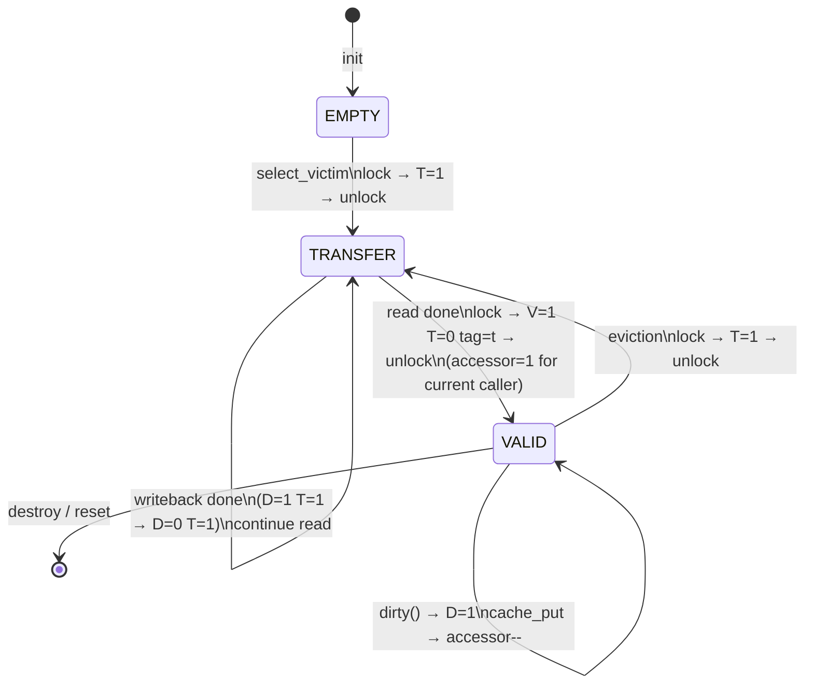

# RavenFS Inode Cache — 缓存行状态机

每个 slot 三个状态位：`V` (valid)、`D` (dirty)、`T` (transfer)。

## 状态定义

| 状态 | V | D | T | accessor | 含义 |
|------|---|---|---|----------|------|
| EMPTY | 0 | 0 | 0 | 0 | 槽从未使用，或已复位 |
| VALID | 1 | 0 | 0 | ≥0 | 数据有效、干净、可用 |
| DIRTY | 1 | 1 | 0 | ≥0 | 数据有效、脏、可用 |
| FETCHING | 0 | ? | 1 | 0 | 读盘进行中，不可用 |
| WRITEBACK | 1 | 1 | 1 | 0 | 写盘进行中，不可用 |

## 状态转换图



## 转换条件

### 基本规则

```
T=0 → T=1  必须在 num_of_accessor == 0 下进行（锁内确认）
T=1 → T=0  由 I/O 完成触发（read/write_block 返回后锁内置位）
```

### cache_get — 命中

```
1. 扫描 8-way 找到 V=1 T=0 tag 匹配的 slot
2. lock → accessor++ → stamp++ → unlock
3. 返回 &data->entries[row]
```

### cache_get — Miss 加载

```
Phase 1（锁内，状态切换）:
  lock → accessor==0 → T=1 → unlock
  FF → FETCHING

Phase 2（无锁，I/O）:
  if D: write_block(data)
  read_block(data)

Phase 3（锁内，状态切换）:
  lock → tag=t, V=1, T=0, accessor=1, stamp → unlock
  → VALID
```

### eviction — 脏回写 + 重载

```
Phase 1（锁内）:
  lock → accessor==0 → T=1 → unlock
  → WRITEBACK

Phase 2（无锁，I/O）:
  write_block(data)           ← 写回旧数据

  read_block(data)            ← 加载新数据（续 T=1）

Phase 3（锁内）:
  lock → tag=t, V=1, T=0, accessor=1, stamp → unlock
  → VALID
```

### flush_inum — 显式刷脏（不换人）

```
Phase 1（锁内）:
  lock → accessor==0 → D=0, T=1 → unlock
  → WRITEBACK（V=1 保持）

Phase 2（无锁，I/O）:
  write_block(data)

Phase 3（锁内）:
  lock → T=0 → unlock
  → VALID（V=1, D=0, tag 不变）
```

## 并发排除

### cache_get 扫描

| slot 状态 | 行为 |
|-----------|------|
| T=1 | 跳过（I/O 未完成） |
| V=0 T=0 | 跳过（空槽，无有效数据） |
| V=1 T=0 tag mismatch | 跳过（hash 冲突，继续扫下一 way） |
| V=1 T=0 tag match | **命中**——开 session，返回 data |

### select_victim 扫描

| slot 状态 | 行为 |
|-----------|------|
| accessor > 0 | 跳过（有人正在用） |
| T=1 | 跳过（I/O 中） |
| V=0 T=0 | **优先选**（空槽，零代价） |
| V=1 T=0 accessor=0 | 候选——记下 stamp 最小的当 victim |
